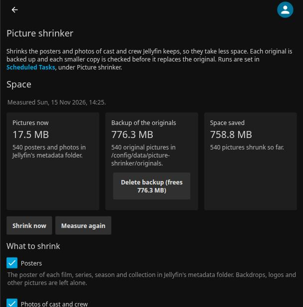

# Picture shrinker for Jellyfin

Works on any Jellyfin 10.11 server; you do not need Starboard.

A Jellyfin plug-in by TheMightyTRexUK, GPLv3 licence.



## What it does

Jellyfin keeps a copy of every poster and every photo of an actor or crew member it shows, often much larger than any
screen needs. On a large library they can take tens of gigabytes. Picture shrinker makes them smaller:

- **Posters** become 900 pixels tall, which is still sharp on a television.
- **Photos of cast and crew** become 400 pixels wide.

Before a picture is replaced, its original is copied to a backup folder, and the smaller copy is checked. If anything
is wrong, the original stays as it was. You can put every original back with one task, and delete the backup when you
are sure.

## How to install it in Jellyfin

You need Jellyfin 10.11 and an administrator account. Everything is in Jellyfin's own dashboard.

1. Open Jellyfin in a web browser and sign in as an administrator.
2. Open the menu, then **Dashboard**.
3. Under **Plugins**, open **Repositories** (in some versions it is a tab called **Repositories** on the **Plugins**
   page).
4. Choose **+** (Add) and fill in:
   - **Repository name:** `Picture shrinker`
   - **Repository URL:** `https://raw.githubusercontent.com/TheMightyTRex/jellyfin-plugin-picture-shrinker/main/manifest.json`
5. Choose **Save**.
6. Open **Catalogue** (under **Plugins**). Find **Picture shrinker** in the **General** group and open it.
7. Choose **Install**, then confirm.
8. Restart Jellyfin: **Dashboard**, then **Restart** (or restart its container or service).

After the restart:

- **The settings** are in **Dashboard**, **Plugins**, **My Plugins**, **Picture shrinker** (choose its card, then
  **Settings**).
- **The tasks** are in **Dashboard**, **Scheduled Tasks**, under **Picture shrinker**: **Shrink pictures** and
  **Restore original pictures**.

Nothing is shrunk until the first run: every Sunday at 03:30, or when you choose **Shrink now** on its settings page.

If you use Starboard, it can do all of this for you in **Settings**, **Apps**, **Jellyfin**, **Picture shrinker**.

## How it works

### What it picks

It looks only in Jellyfin's metadata folder (in the official Docker image, `/config/metadata`):

| Picture | Where Jellyfin keeps it | Shrunk to |
|---|---|---|
| Posters | `poster.jpg`, `poster.png` or `poster.webp` under `library` | At most 900 pixels tall (**Posters no taller than**) |
| Photos of cast and crew | Pictures under `People` | At most 400 pixels wide (**Photos of people no wider than**) |

Backdrops, logos, thumbnails, pictures saved beside your media files and every other picture are left alone. A picture
that is already small enough is only opened to read its size, never written. Each picture keeps its format: JPEG and
WebP at **Quality** 85, PNG lossless. You can leave out posters or photos of people with **What to shrink**.

### The checks before a replace

For each picture that is too big:

1. A smaller copy is written to a hidden file beside it.
2. The copy is opened again and decoded in full, and must have exactly the new size and the original's format.
3. The copy must be smaller in bytes than the original. If it is not, the original is kept.
4. With backup activated, the original is copied to the backup folder (see below). If that fails, the picture is not
   shrunk.
5. The copy takes the original's file mode and owner and replaces it in one step (a rename), so Jellyfin never reads
   half a picture.

A picture that cannot be read is left as it is and listed on the settings page with the reason.

### When it runs

- **Shrink pictures** is a task in Jellyfin's **Scheduled Tasks**. It runs every Sunday at 03:30 until you change its
  triggers there: every day or every week, at the time you choose. **Once a month** on the settings page makes a
  weekly trigger run only the first time in each month.
- **Shrink now** on the settings page, or the run button in **Scheduled Tasks**, starts a run straight away. Stop it
  in **Scheduled Tasks**; it stops after the picture it is on.
- A run stops itself after 115 minutes, and the next run carries on: pictures already shrunk are only opened.
- It works at the lowest priority (nice 19 and the idle disk class), so people can watch while it runs.
- **Shrink new pictures soon after Jellyfin saves them** is deactivated by default. When activated, the posters and
  photos Jellyfin saves for new films, series and people are shrunk once they are 10 minutes old (**Wait before
  shrinking a new picture**), with the same checks and backup.
- A finished run sends no notification. Its only result is the figures on the settings page; Jellyfin's own
  **Scheduled Tasks** keeps its usual history of when each task ran.

### The backup

**Back up each original before it is replaced** is activated by default:

- Each original is copied once, before its first shrink, to the backup folder, keeping its place under `library` or
  `People`, so each one can be matched back. The folder is `picture-shrinker/originals` in Jellyfin's data folder
  (in the official Docker image, `/config/data/picture-shrinker/originals`) unless you choose another in
  **Backup folder**.
- A copy already in the backup is never replaced, so a picture shrunk again at a new size still has its first
  original there.
- If the copy fails, or the backup disk would have less than 100 MB free, the picture is not shrunk and the run says
  why.
- **Restore original pictures**, in **Scheduled Tasks**, puts every original back where it came from and keeps the
  backup. It runs only when you choose it.
- **Delete backup**, on the settings page, removes the backup for good, after asking you. It frees the space the
  backup shows. It removes only the pictures the shrinker put in the backup folder, never anything outside it, and is
  not available while a run is going.

If you deactivate backup, the settings page warns that pictures shrunk from then on cannot be put back.

### The Space section

The settings page shows, measured when the page opens and after each thing you do on it:

- **Pictures now:** the size and number of the posters and photos it looks after.
- **Backup of the originals:** the size and number of pictures in the backup, with **Delete backup** and the space it
  frees.
- **Space saved:** the space saved now and how many pictures are shrunk. Pictures put back by **Restore original
  pictures** no longer count.

Below, **Last runs** lists each run: when, what started it, how many were shrunk, left as they were and not shrunk,
the space saved, and how it ended.

## Risks, and how to undo them

- **Pictures are changed in place.** Jellyfin shows the smaller picture straight away. With backup activated (the
  default) you can put the originals back; without it you cannot.
- **The backup uses space until you remove it.** The first run copies every picture it shrinks, so it may need almost
  as much free space as the pictures take now. The Space section shows how much. When you are happy with the
  pictures, **Delete backup** frees it.
- **Deleting the backup cannot be undone.** After **Delete backup**, **Restore original pictures** can no longer put
  those pictures back. The shrunk pictures stay.
- **Smaller pictures look softer on very large screens.** 900 pixels tall is sharp on a television; on a large 4K
  screen up close a poster may look a little soft. Choose a larger size, or a higher **Quality**, if it matters to
  you. A picture already shrunk is not made larger again: restore it first.
- **Jellyfin may download bigger pictures again.** **Refresh metadata** with **Replace existing images** fetches new,
  full-size pictures. The next run shrinks them, but their backup is not replaced: the backup keeps the first original.
- **A run uses processor time.** It works at the lowest priority, but on a small server choose a quiet time for
  **Shrink pictures**, such as the night.
- **Do not run two shrinkers.** If you also use Starboard's Picture shrinker plug-in, it sees that this one is
  installed and stays idle, so the two never shrink the same pictures. Other tools that change Jellyfin's pictures
  should not run at the same time.

### Put the original pictures back

1. In **Dashboard**, **Scheduled Tasks**, **Shrink pictures**, remove its triggers (or the next run shrinks them
   again).
2. Run **Restore original pictures**.
3. In Jellyfin, a film or series may show the old picture until the page reloads.

### Remove the plug-in cleanly

1. To keep the pictures as they are now, skip to step 3. To put the originals back, follow the steps above first.
2. To free the backup's space, choose **Delete backup** on the settings page.
3. In **Dashboard**, **Plugins**, **My Plugins**, open **Picture shrinker** and choose **Uninstall**, then restart
   Jellyfin.
4. If you did not delete the backup, its folder stays in Jellyfin's data folder (`picture-shrinker/originals`); you
   can delete it yourself. Two small files stay too, which you can delete: its settings,
   `plugins/configurations/Jellyfin.Plugin.PictureShrinker.xml`, and its figures, `plugins/Jellyfin.Plugin.PictureShrinker`,
   both in Jellyfin's configuration folder (`/config` in the official Docker image).

## How much it uses

Measured on 15 November 2026 on a sample of 540 made-up pictures (300 posters at 2,000 by 3,000 pixels and 240 photos
at 1,365 by 2,048), in a throwaway Jellyfin 10.11.11 container limited to 2 processors and 1.5 GB of memory, against
the Starboard version on the same sample.

| | Jellyfin version (this plug-in) | Starboard version |
|---|---|---|
| Where it runs | Inside Jellyfin | Its own container beside Jellyfin |
| Memory at rest | No change measurable: Jellyfin with the plug-in was 164 MB, as before the run | 13 MB (its whole container) |
| Memory at the peak of a run | About 20 MB more than Jellyfin at rest (183 MB against 164 MB) | 33 MB (its whole container) |
| Memory after a run | Back to Jellyfin at rest (164 MB) | 23 MB (the image library stays loaded) |
| Processor time for the run | 35 seconds | 39 seconds |
| Time the run took | 55 seconds (one processor at most, as it uses one thread) | 80 seconds (capped at half a processor) |
| Pictures shrunk | 540 of 540 | 540 of 540 |
| Space saved | 758.8 MB (776.3 MB to 17.5 MB) | 758.4 MB (776.3 MB to 17.9 MB) |
| Jellyfin's answers during the run | `/System/Info` every 2 seconds: median 25 ms, slowest 68 ms (at rest: 30 ms and 59 ms) | Not affected (a separate container) |

Both work at the lowest priority. The Jellyfin version uses slightly less processor time and, with no container of its
own, less memory at rest; the Starboard version keeps its memory apart from Jellyfin's. An earlier build of this
plug-in kept about 60 MB after a run; it now hands that memory back when each run ends.

## Why SkiaSharp

Jellyfin 10.11 already loads SkiaSharp 3.116 for its own pictures (`Jellyfin.Drawing.Skia`), with its native library
for amd64 and arm64. This plug-in uses that copy: the release zip holds only the plug-in's own DLL (about 100 KB), so
there is nothing native to ship, nothing to download, and no second copy of an image library in memory. ImageSharp
would have added about 2 MB to every install and a second decoder, and its licence needs care for some uses.

## Build it

The build runs in Docker with the .NET 9 SDK, the version Jellyfin 10.11 targets:

```
tools/dotnet.sh test tests/Jellyfin.Plugin.PictureShrinker.Tests   # unit tests and the shared test pictures
tools/package.sh 1.1.0.0                                           # artifacts/picture-shrinker_1.1.0.0.zip and its checksum
```

A release is one step: push a tag such as `v1.1.0.0`. The **Release** workflow builds and tests it, makes the zip and
its MD5 checksum, creates the GitHub release, and adds the version to `manifest.json`.

The rules (sizes, quality, checks, backup) are in `rules.json`, shared with Starboard's version. [SYNC.md](SYNC.md)
says how the two are kept in step.

## Licence

GNU General Public Licence version 3 ([LICENSE](LICENSE)), as Jellyfin plug-ins need. Copyright 2026 TheMightyTRexUK.
