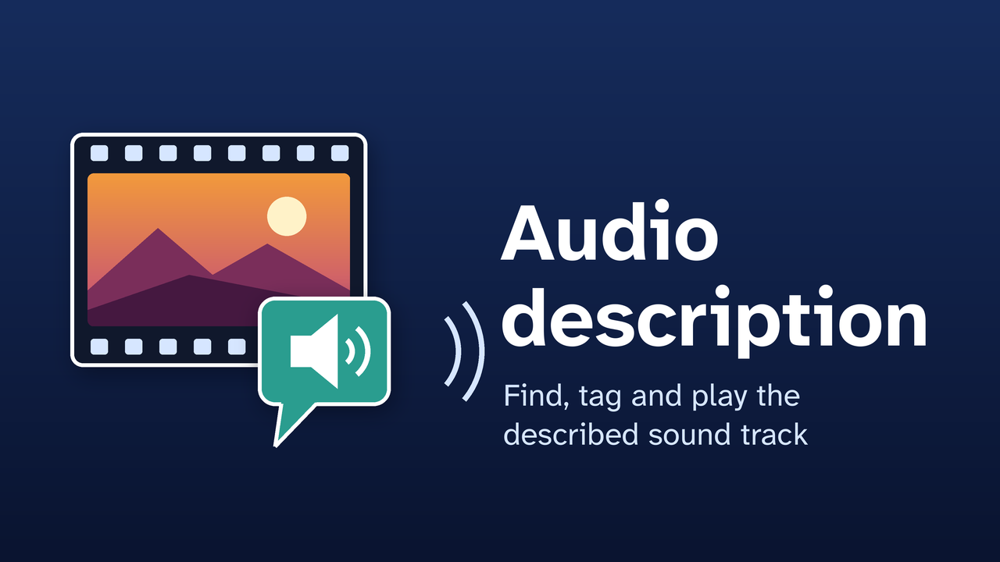

# Audio description for Jellyfin

Works on any Jellyfin 10.11 or Jellyfin 12 server; you do not need Starboard.

A Jellyfin plug-in by TheMightyTRexUK, GPLv3 licence. Every task, with pictures, is in the
[help centre](https://themightytrex.github.io/jellyfin-plugins/).



The logo shows a film frame with a sunset scene and a teal speech bubble with a loudspeaker in it, the narrator, with
sound waves coming from it, beside the name. It is drawn by `tools/make-logo.py` and matches Picture shrinker's.

Audio description is a second sound track in which a narrator says what is happening, for blind and partially
sighted people. Many films and series have one, but Jellyfin does not mark which, and every app plays the first
sound track unless you choose another. This plug-in does three things:

- **Find and tag:** it finds every film and episode with a described sound track and gives it, and its series, the
  tag **Audio description**. It can also put them in a collection called **Audio description**. Every Jellyfin app,
  televisions included, shows tags and collections, so this works everywhere.
- **Play the described track:** for each person who chooses it, when they start a title with a described track and
  another sound track is playing, Jellyfin asks their app to change to the described track.
- **Add a track you have:** a description track you already have, such as one from AudioVault, is added next to its
  film or episode, after a check that the lengths match.

## How to install it in Jellyfin

You need Jellyfin 10.11 or Jellyfin 12 and an administrator account. Everything is in Jellyfin's own dashboard. The
repository has a build for each: Jellyfin installs the one for its own version (1.0.1.0 on Jellyfin 12, 1.0.0.0 on
Jellyfin 10.11).

| Your Jellyfin | Version it installs | Built for |
|---|---|---|
| 12.0 to 12.4 | 1.0.1.0 | .NET 10 |
| 10.11 | 1.0.0.0 | .NET 9 |

To find your version, go to **Dashboard**: the version is under the server name in the menu.

1. Open Jellyfin in a web browser and sign in as an administrator.
2. Open the menu, then **Dashboard**, then **Plugins**.
3. Choose **Manage Repositories** (on Jellyfin 10.11: the **Repositories** tab), then **New Repository** (on 10.11:
   **+**). Fill in:
   - **Repository Name:** `TheMightyTRexUK`
   - **Repository URL:** `https://raw.githubusercontent.com/TheMightyTRex/jellyfin-plugins/main/manifest.json`

   One address holds every Jellyfin plug-in by TheMightyTRexUK, Picture shrinker among them. If you added it for
   another of them, skip to step 5.
4. Choose **Add** (on 10.11: **Save**).
5. Back on **Plugins**, choose **Available** (on 10.11: the **Catalogue** tab) and search for `Audio`. Open
   **Audio description**.
6. Choose **Install**, then **Install** again to confirm.
7. Restart Jellyfin: **Dashboard**, then **Restart** (or restart its container or service).

After the restart:

- **The settings** are in **Dashboard**, **Plugins**: choose **Installed** (on 10.11: **My Plugins**), open
  **Audio description**, then **Settings**.
- **The tasks** are in **Dashboard**, **Scheduled Tasks**, under **Audio description**: **Find and tag audio
  description** and **Add description tracks**.

The first Find and tag runs at 04:20, or after the next library scan, or when you choose **Find and tag now** on the
settings page.

If you use Starboard, its Audio description and Audio description tracks plug-ins notice this one and stay idle for
the parts it does, so the two never tag or add the same thing twice.

## Find and tag

A track counts as audio description when its title, the title Jellyfin shows or its comment has one of these words:
**Audio Description**, **Audio described**, **Descriptive audio**, **Descriptive video**, **Described**, **DVS**, or
**AD** as a word of its own (so "Adventure" and "Madrid" never count). A track with **commentary** or **comment** in
it never counts, so "AD commentary" is left out. Jellyfin does not read the flag that marks a described track inside a
file, so the words are what can be read.

- **When it runs:** every night at 04:20, after each library scan (**Find and tag after each library scan**, active by
  default), and when you choose **Find and tag now**. A film given a track by **Add a track you have** is tagged as
  soon as Jellyfin has read it again.
- **What it tags:** each film and each episode with a described track, and each series with at least one, with the
  tag **Audio description**. Other tags stay as they are.
- **When the track goes:** the next run takes the tag off. A tag of the same name that you added yourself to a title
  with no described track is taken off too.
- **The collection:** while **Add them to the Audio description collection** is active (the default), the films and
  series with a described track are in one collection called **Audio description**, and the ones without are taken
  out of it. Jellyfin keeps it with your other collections. Deactivate it and the collection stays as it is: remove it
  in Jellyfin if you do not want it.
- **What it writes:** only the titles whose tag changes, through Jellyfin's own library, as an edit in the metadata
  editor would. It reads the library one item at a time, so memory stays flat whatever its size.

To find the titles in an app, filter a library by the tag **Audio description**, or open the **Audio description**
collection.

## Play the described track

On the settings page, under **Play the described track**, tick each person who wants it. It is inactive for everyone
until you tick someone.

When a person who chose it starts a film or episode with a described track, the plug-in waits 2 seconds for the app to
be ready. If the sound track playing is not the described one, it sends the app Jellyfin's own command to change the
sound track (SetAudioStreamIndex), the same command Jellyfin's apps send each other.

**Not every Jellyfin app accepts this.** Each app tells Jellyfin which commands it accepts. Jellyfin's web app is one
that accepts it; an app that does not say it does is left alone, and Jellyfin's log says so, with the app's name:
"does not accept the command to change the sound track". In those apps, choose the described track in the player.
Jellyfin remembers that choice for each film and series when **Remember audio selections** is active in the person's
**Playback** settings.

## Add a track you have

1. Get the track yourself, for example from AudioVault after signing in there. Keep to its rules.
2. Put the file in the folder, or upload it on the settings page under **Upload a description track** (up to 1 GB).
   The folder is `audio-description` in Jellyfin's data folder (in the official Docker image,
   `/config/data/audio-description`; in the LinuxServer.io image, `/config/data/data/audio-description`) unless you
   choose another in **Folder for description tracks**. MP3, M4A, M4B, AAC, MKA, Opus, Ogg, FLAC and WAV files work,
   and so does a zip of them.
3. Name it as the film and its year, such as `Dune (2021).mp3`, or a series with its episode, such as
   `Slow Horses S01E03.mp3`. When more than one title could match, choose the right one on the settings page.
4. The plug-in copies the sound into a hidden Matroska file, without converting it, using Jellyfin's own ffmpeg, so
   its length is exact. It compares that length with the film's, read by Jellyfin's own ffprobe.
5. When they agree within 5 seconds (**How close the lengths must be**, 1 to 30), it moves the copy next to the film
   as `Dune (2021).Audio Description.eng.mka`, titled **English (Audio Description)**, with the visual impaired flag
   and not the default track, and asks Jellyfin to read the film again. Jellyfin loads it as an extra sound track; the
   film's own file is not changed.
6. Play the film, choose the **English (Audio Description)** sound track, and say on the settings page whether it
   plays in step. **Yes: put the original away** moves the original to the **Confirmed** folder; **No: take the track
   off** moves the added track to the **Taken off** folder.

The folder is checked every 5 minutes while **Check the folder every 5 minutes** is active (the default): each check
only lists the folder, and a new file is checked straight away. It is also checked every night at 04:40 and when you
choose **Check the folder now**.

### When the lengths differ

A description track is made for one cut of a film. A different length, by more than a few seconds, almost always
means your copy is another cut: an extended edition, a director's cut, a version with different studio logos at the
start, or a broadcast with its own credits. The plug-in says how much longer or shorter the track is and does not add
it. Find a track for your cut, or line the track up yourself with describealign
(<https://pypi.org/project/describealign/>), then put the result in the folder.

### What it never does

- Download from, or read pages of, any website, AudioVault included.
- Change a film's own file, or replace a description track that is already there.
- Delete anything of yours. It moves files to **Confirmed**, **Taken off** and **Unzipped** inside the folder, and you
  delete them there when you like. The only files it removes are its own hidden working copies.

Jellyfin needs to be able to write in your film and series folders to add a track. If it cannot, the track says
**Not added** with the reason.

## Risks, and how to undo them

- **Tags and the collection change your library's metadata.** To undo them, deactivate the collection, remove the
  **Audio description** tag in Jellyfin's metadata editor, or uninstall the plug-in first and then remove them.
- **An added track is a file next to the film.** **No: take the track off** moves it to **Taken off**. After that,
  Jellyfin no longer lists it.
- **Play the described track changes the sound track for the people you tick**, each time they start a described
  title. They can choose another track in the player as usual. Untick them to stop it.

### Remove the plug-in cleanly

1. To take the tags off first, deactivate **Add them to the Audio description collection**, then remove the tag in
   Jellyfin; or keep them, as they do no harm.
2. In **Dashboard**, **Plugins**, **Installed** (on Jellyfin 10.11: **My Plugins**), open **Audio description** and
   choose **Uninstall**, then restart Jellyfin.
3. Added tracks stay next to their films and keep working. The folder for description tracks stays, with its
   **Confirmed**, **Taken off** and **Unzipped** folders: delete them yourself. Two small files stay too: its
   settings, `plugins/configurations/Jellyfin.Plugin.AudioDescription.xml`, and its records,
   `plugins/Jellyfin.Plugin.AudioDescription`, both in the folder that holds Jellyfin's `plugins` folder.

## Build it

One source makes two builds. `JELLYFIN_TARGET` picks which: `12` (the default) builds for Jellyfin 12 with the .NET 10
SDK, and `10.11` builds for Jellyfin 10.11 with the .NET 9 SDK. The builds run in Docker, from the top of the
jellyfin-plugins repository:

```
JELLYFIN_TARGET=12 tools/dotnet.sh audio-description test tests/Jellyfin.Plugin.AudioDescription.Tests      # unit tests and the rules file
JELLYFIN_TARGET=10.11 tools/dotnet.sh audio-description test tests/Jellyfin.Plugin.AudioDescription.Tests   # the same for the 10.11 build
```

The release zips, their checksums and `manifest.json` are made by the jellyfin-plugins repository's own tools and
workflows, for every plug-in in it ([CONTRIBUTING.md](../CONTRIBUTING.md)). [SYNC.md](SYNC.md) explains the version numbers.

The rules (the words that mean audio description, the tag, the collection, the file names and the length check) are
in `rules.json`, shared with Starboard's version. [SYNC.md](SYNC.md) says how the two are kept in step.

## Licence

GNU General Public Licence version 3 ([LICENSE](LICENSE)), as Jellyfin plug-ins need. Copyright 2026 TheMightyTRexUK.
