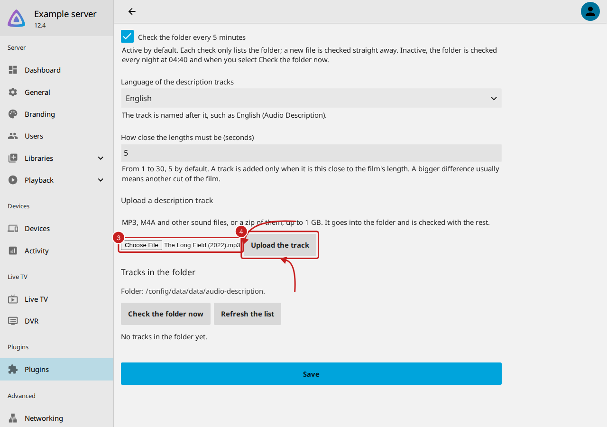
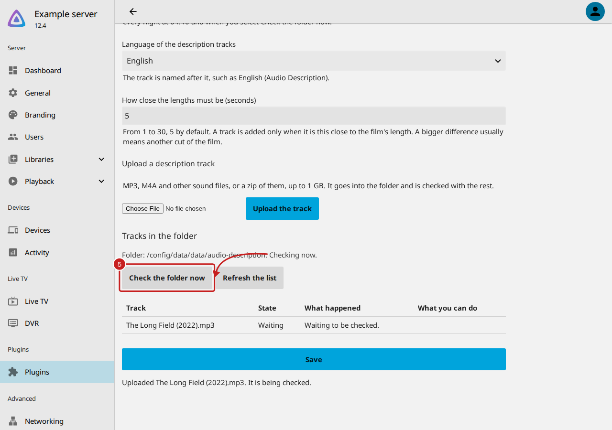
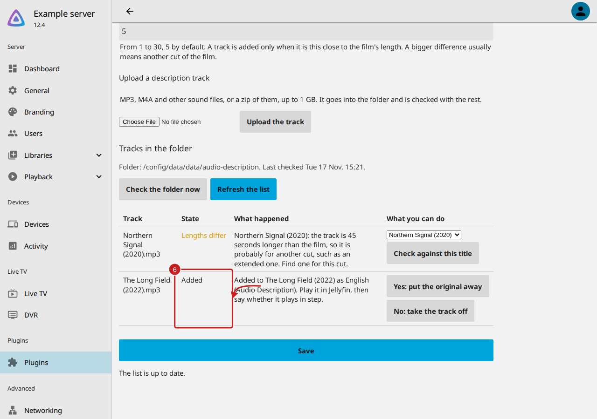
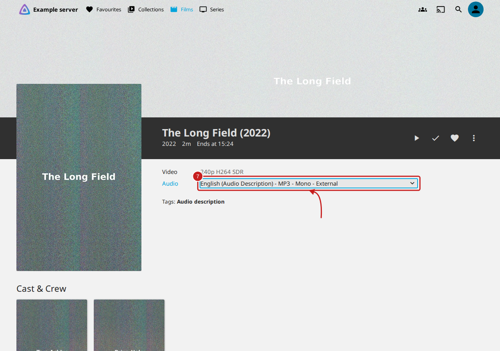
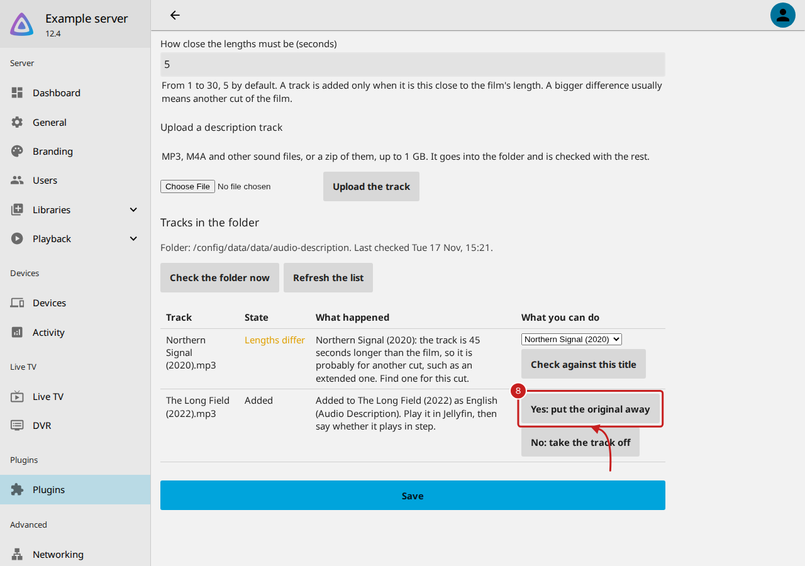

[Help centre](../README.md) · Audio description · how-to
<!-- help: plugins / audio-description -->

# Add a description track you have

<!-- not-released: audio-description -->
> [!NOTE]
> **Audio description is not released yet,** so Jellyfin's catalogue does not list it. This page describes version
> 1.0.1.0 for Jellyfin 12 and 1.0.0.0 for Jellyfin 10.11.

Add a description track you already have, such as one from AudioVault, to its film or episode. The plug-in checks
that the track is as long as your copy of the film, then adds it next to the film as an extra sound track. The film's
own file is never changed, and nothing is ever deleted. This takes 8 steps.

## Before you begin

- Audio description is installed. Read [Install Audio description](install.md).
- You have the track: get it yourself, for example from AudioVault after signing in there, and keep to its rules.
  The plug-in downloads nothing from any website.
- The track is one of these: MP3, M4A, M4B, AAC, MKA, Opus, Ogg, FLAC or WAV, or a zip of them, up to 1 GB.
- Jellyfin can write in your film and series folders. If it cannot, the track says **Not added** with the reason.

## Steps

1. Name the file as the film and its year, such as `The Long Field (2022).mp3`, or a series with its episode, such
   as `Quiet Valley S01E03.mp3`. `1x03` works for an episode too.
2. Go to **Dashboard**, **Plugins**, **Installed**, select **Audio description**, then **Settings**.
3. Under **Add a track you have**, then **Upload a description track**, select the file chooser (**Choose File**, or
   **Browse** in some browsers) and choose the file. A screen reader names it Choose a description track.
4. Select **Upload the track**. The file goes into the folder for description tracks.

   

   You can also put the file in the folder yourself. **Folder for description tracks** names it; empty, it is
   `audio-description` in Jellyfin's data folder (`/config/data/audio-description` in the official Docker image,
   `/config/data/data/audio-description` in the LinuxServer.io image).

5. Under **Tracks in the folder**, select **Check the folder now**. While **Check the folder every 5 minutes** is
   active, the default, a new file is checked within 5 minutes anyway.

   

6. Read the track's **State**. **Added** means the lengths agreed and the track is next to the film; **What
   happened** says which film it went to. Any other state says what happened and what you can do: read [The states](#the-states).

   

7. Play the film in Jellyfin and choose **English (Audio Description)** in **Audio** on its page, or in the player's
   sound track menu. Listen for a minute or two, at the start and later on.

   

8. Back on the settings page, say whether it plays in step:
   - **Yes: put the original away** moves the file you added to the **Confirmed** folder, inside the folder for
     description tracks.
   - **No: take the track off** moves the added track to the **Taken off** folder, and Jellyfin no longer lists it.

   

## The length check

A description track is made for one cut of a film. The plug-in copies the sound into a hidden Matroska file without
converting it, using Jellyfin's own ffmpeg, so its length is exact. It compares that length with the film's, read by
Jellyfin's own ffprobe.

- When they agree within 5 seconds, it moves the copy next to the film, as `The Long Field (2022).Audio
  Description.eng.mka`, titled **English (Audio Description)**, marked for people with a visual impairment and not the
  default track. Then it asks Jellyfin to read the film again.
- To allow more or less, change **How close the lengths must be (seconds)**, from 1 to 30, and select **Save**.
- **Language of the description tracks** sets the language and the track's name, such as **English (Audio
  Description)**.

## The states

| State | What it means | What to do |
|---|---|---|
| **Waiting** | Not checked yet | Select **Check the folder now** |
| **Added** | Added next to the film | Play it, then select **Yes** or **No** |
| **Confirmed** | You said it plays in step | Nothing: the file you added is in **Confirmed** |
| **Taken off** | You said it does not | Choose a title to try again, or find another track |
| **Lengths differ** | The track is longer or shorter than your copy: probably another cut | Find a track for your cut, or line it up yourself |
| **Choose the title** | More than one title could match the name | Choose the right one, then **Check against this title** |
| **No match** | Nothing in Jellyfin matches the name | Rename the file as the film and year, or the series and episode |
| **Already described** | The title already has a described sound track | Nothing, or choose another title if this is wrong |
| **Already added** | A description track file is already next to it | Nothing: it is never replaced |
| **Out of reach**, **Cannot read**, **Cannot read film**, **Not added** | The file or the film could not be read or written | Read [Audio description is not working](../fix/audio-description-problems.md) |

## When the lengths differ

A difference of more than a few seconds almost always means your copy is another cut: an extended edition, a
director's cut, a version with different studio logos at the start, or a broadcast with its own credits. The plug-in
says how much longer or shorter the track is and does not add it. Find a track for your cut, or line the track up
yourself with [describealign (opens in a new tab)](https://pypi.org/project/describealign/), then put the result in
the folder.

## What it never does

- Download from, or read pages of, any website, AudioVault included.
- Change a film's own file, or replace a description track that is already there.
- Delete anything of yours. It moves files to **Confirmed**, **Taken off** and **Unzipped** inside the folder, and you
  delete them there when you like. The only files it removes are its own hidden working copies.

## Find out more

- [Find the films and series with audio description](find-and-tag.md)
- [Play the described track for the people who want it](play-the-described-track.md)
- [Audio description is not working](../fix/audio-description-problems.md)
