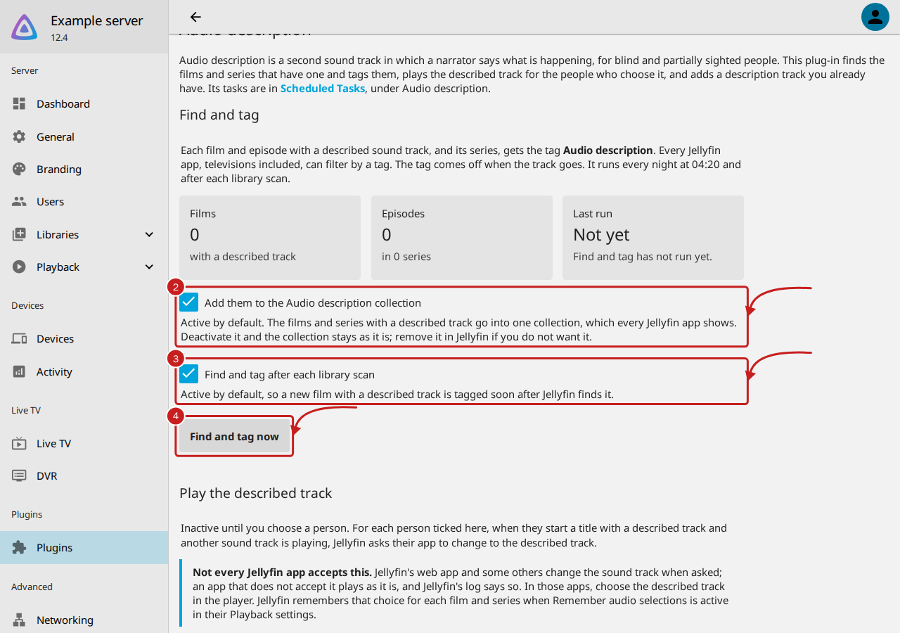
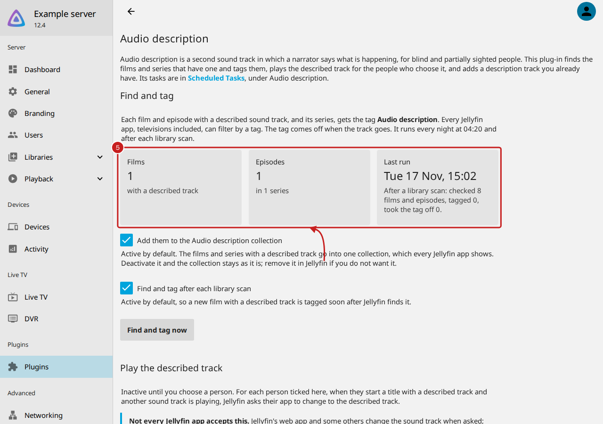
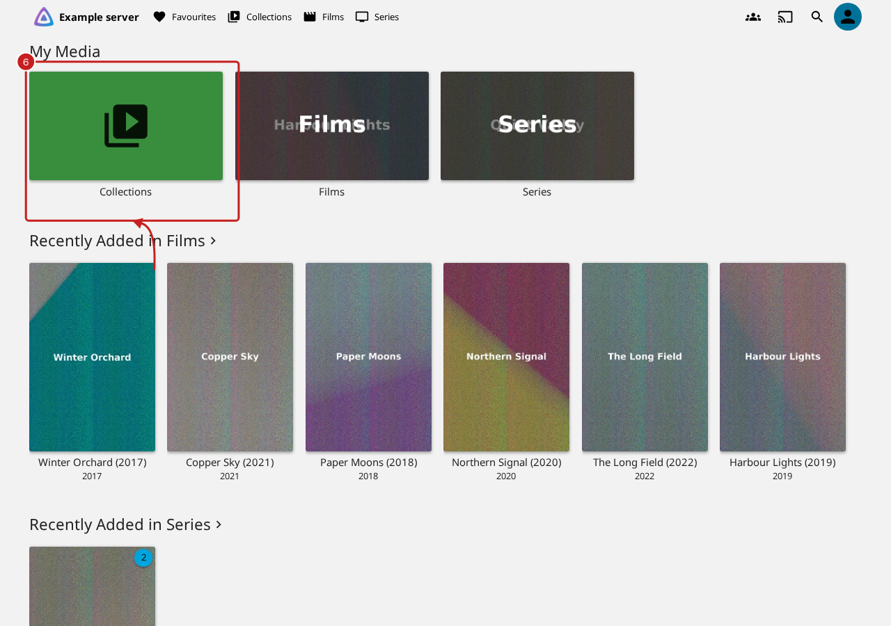
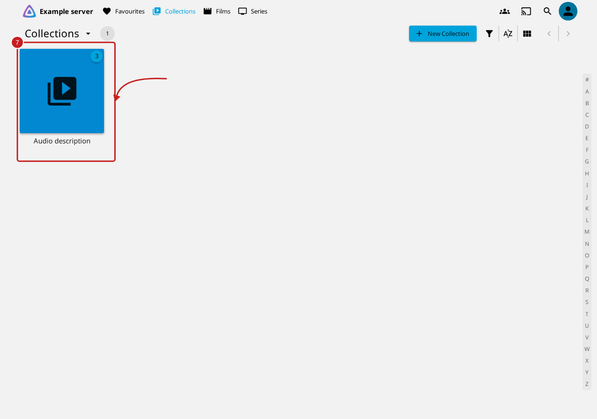
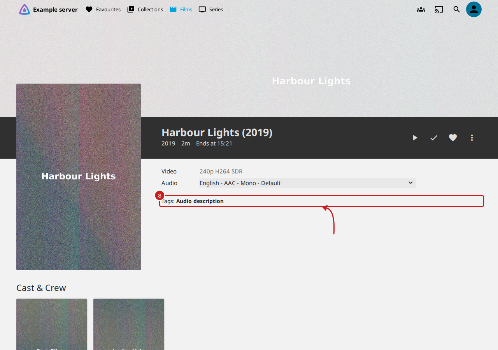

[Help centre](../README.md) · Audio description · how-to
<!-- help: plugins / audio-description -->

# Find the films and series with audio description

<!-- not-released: audio-description -->
> [!NOTE]
> **Audio description is not released yet,** so Jellyfin's catalogue does not list it. This page describes version
> 1.0.1.0 for Jellyfin 12 and 1.0.0.0 for Jellyfin 10.11.

Audio description gives every film and episode with a described sound track, and its series, the tag **Audio
description**, and puts the films and series in a collection called **Audio description**. Every Jellyfin app,
televisions included, shows tags and collections, so the described titles can be found in any app. This takes 8
steps.

## Before you begin

- Audio description is installed. Read [Install Audio description](install.md).

## Steps

1. Go to **Dashboard**, **Plugins**, **Installed**, select **Audio description**, then **Settings**.
2. Under **Find and tag**, keep **Add them to the Audio description collection** active to have the collection. It is
   active by default. Deactivate it and the collection stays as it is: remove it in Jellyfin if you do not want it.
3. Keep **Find and tag after each library scan** active, so a new film with a described track is tagged soon after
   Jellyfin finds it. It is active by default. Then select **Save**, at the end of the page, if you changed either.
4. Select **Find and tag now** to tag straight away.

   

5. Read the figures: how many **Films** have a described track, how many **Episodes** in how many series, and the
   **Last run**, with what it checked, tagged and took the tag off.

   

6. To find the titles, go to Jellyfin's home page and select **Collections**, under **My Media**.

   

7. Select the **Audio description** collection. It holds the films and series with a described track.

   

8. On a film's or series' page, **Tags** shows **Audio description**. Select the tag to list every title that has it.
   In a library, the filter's **Tags** list has it too.

   

## How a track is found

A sound track counts as audio description when its title, the title Jellyfin shows or its comment has one of these
words:

- **Audio Description**, **Audio described**, **Descriptive audio** or **Descriptive video**;
- **Described**;
- **DVS**, or **AD** as a word of its own, so "Adventure" and "Madrid" never count.

A track with **commentary** or **comment** in it never counts, so "AD commentary" is left out. Jellyfin does not read
the flag that marks a described track inside a file, so these words are what can be read.

## When it runs, and what it changes

- **When:** every night at 04:20, after each library scan while **Find and tag after each library scan** is active,
  and when you select **Find and tag now**. A film given a track by [Add a description track you have](add-a-track.md)
  is tagged as soon as Jellyfin has read it again.
- **What it tags:** each film and each episode with a described track, and each series with at least one. Other tags
  stay as they are.
- **When the track goes:** the next run takes the tag off. A tag of the same name that you added yourself to a title
  with no described track is taken off too.
- **The collection:** holds films and series, not episodes. Titles without a described track are taken out of it.
- **What it writes:** only the titles whose tag changes, through Jellyfin's own library, as an edit in the metadata
  editor would. It reads the library one item at a time, so its memory stays the same whatever the library's size.

## Find out more

- [Play the described track for the people who want it](play-the-described-track.md)
- [Add a description track you have](add-a-track.md)
- [Audio description is not working](../fix/audio-description-problems.md)
