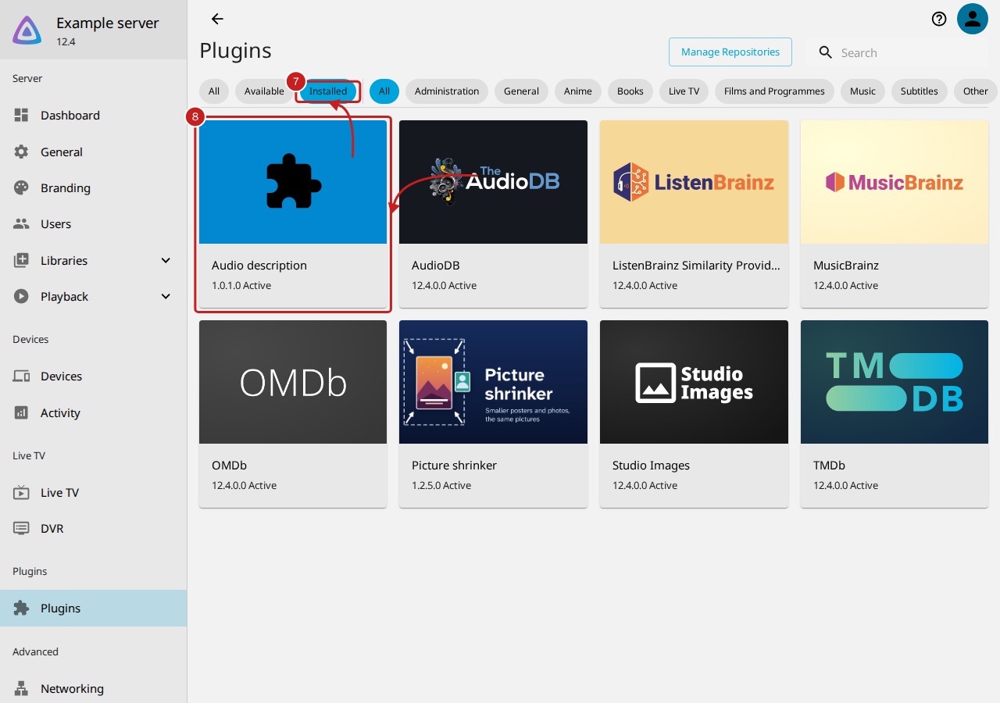
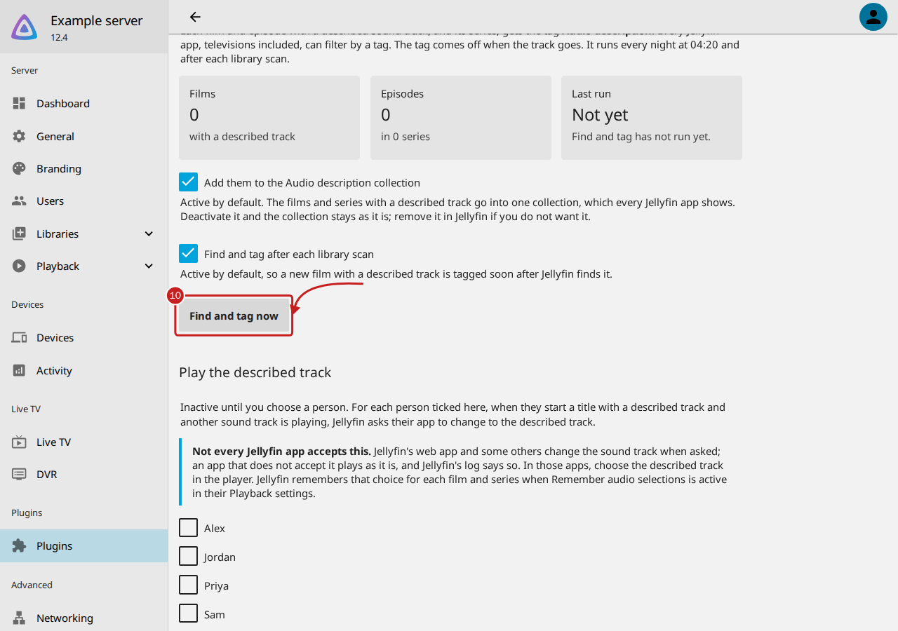
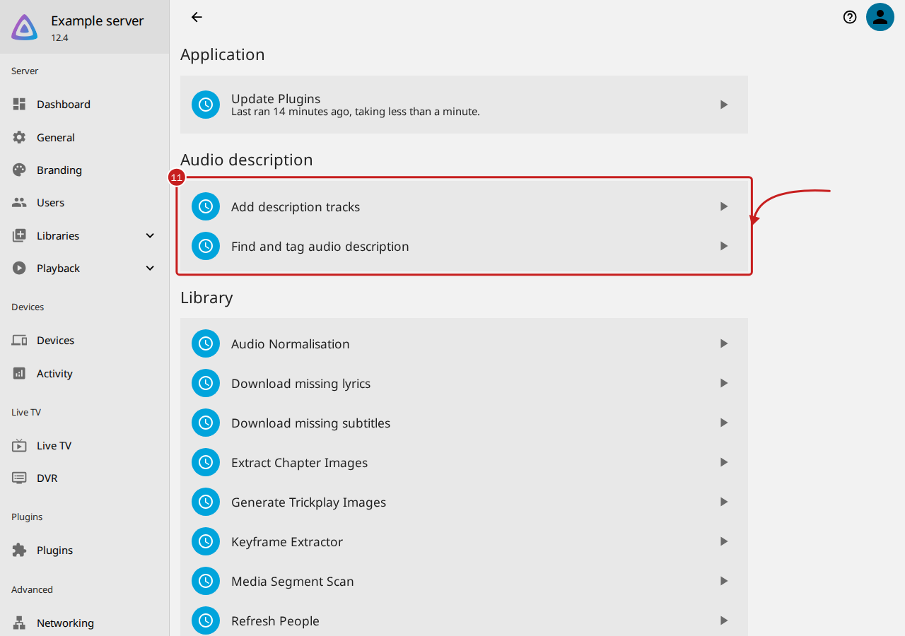

[Help centre](../README.md) · Audio description · how-to
<!-- help: plugins / audio-description -->

# Install Audio description

<!-- not-released: audio-description -->
> [!NOTE]
> **Audio description is not released yet,** so Jellyfin's catalogue does not list it. This page describes version
> 1.0.1.0 for Jellyfin 12 and 1.0.0.0 for Jellyfin 10.11.

Install Audio description from Jellyfin's own catalogue and restart Jellyfin. Audio description is a second sound
track in which a narrator says what is happening, for blind and partially sighted people. The plug-in finds and tags
the films and series that have one, plays it for the people who choose it, and adds a description track you have.
This takes 11 steps and about 5 minutes, with a restart.

## Before you begin

- The repository is in Jellyfin. Read [Add the repository to Jellyfin](../start/add-the-repository.md).
- An administrator account in Jellyfin 10.11 or Jellyfin 12. Jellyfin installs the build for its own version.
- Restarting Jellyfin stops anyone watching for about a minute: choose a quiet time.

## Steps

Steps 1 to 6 are the same as for Picture shrinker, with `Audio` as the search; [Install Picture shrinker](../picture-shrinker/install.md)
has a picture of each.

1. Go to **Dashboard**, then **Plugins**, and select **Available**.
2. In **Search**, enter `Audio`, and select the **Audio description** card.
3. Select **Install**.
4. In **Confirm Plugin Installation**, select **Install**.
5. Go to **Dashboard** and select **Restart**.
6. In the **Restart** dialog, select **Restart**. Jellyfin starts again in about a minute.
7. When Jellyfin is back, go to **Dashboard**, then **Plugins**, and select **Installed**.
8. Select the **Audio description** card. Its version and **Active** are under its name.

   

9. Select **Settings**. The settings page opens, with three parts: **Find and tag**, **Play the described track** and
   **Add a track you have**.
10. Select **Find and tag now** to tag the films and series with a described track straight away. Otherwise it runs
    at 04:20 each night and after each library scan.

    

11. To check its tasks, go to **Dashboard**, then **Scheduled Tasks**. They are under **Audio description**: **Add
    description tracks** and **Find and tag audio description**.

    

Nothing else needs setting up: tagging and the collection are active by default. **Play the described track** is
inactive until you choose a person.

## Things to note

- Jellyfin 10.11.11 has the same pages and names. On a **Plugins** page with tabs, **Installed** is the **My Plugins**
  tab and **Available** is the **Catalogue** tab.
- If you use Starboard, its Audio description and Audio description tracks plug-ins notice this one and stay idle
  for the parts it does. Read [Use the plug-ins with Starboard](../start/use-with-starboard.md).

## Remove it

1. To take the tags off first, deactivate **Add them to the Audio description collection**, then remove the tag in
   Jellyfin's metadata editor; or keep them, as they do no harm.
2. Go to **Dashboard**, **Plugins**, **Installed**, select **Audio description**, then **Uninstall**, and restart
   Jellyfin.

Added tracks stay next to their films and keep working. The folder for description tracks stays, with its
**Confirmed**, **Taken off** and **Unzipped** folders: delete them yourself when you like. Two small files stay too:
its settings, `plugins/configurations/Jellyfin.Plugin.AudioDescription.xml`, and its records,
`plugins/Jellyfin.Plugin.AudioDescription`.

## If it does not work

- If Audio description is not in **Available**, read [A plug-in is not in Jellyfin's catalogue](../fix/plug-in-not-in-the-catalogue.md).
- If something else is wrong, read [Audio description is not working](../fix/audio-description-problems.md).

## Find out more

- [Find the films and series with audio description](find-and-tag.md)
- [Play the described track for the people who want it](play-the-described-track.md)
- [Add a description track you have](add-a-track.md)
- [Audio description's README on GitHub](../../audio-description/README.md)
