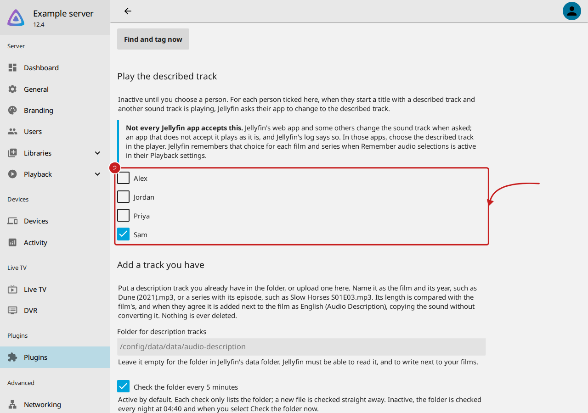
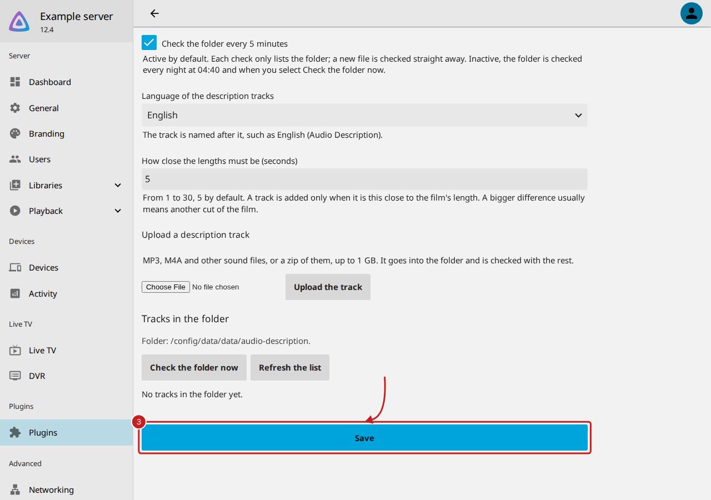
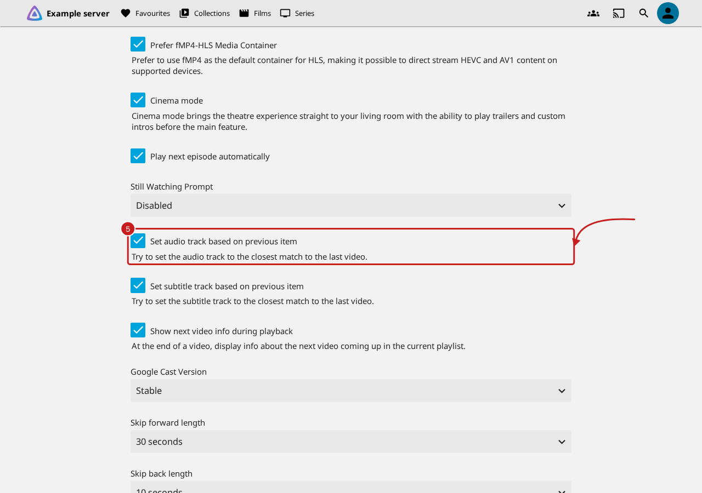
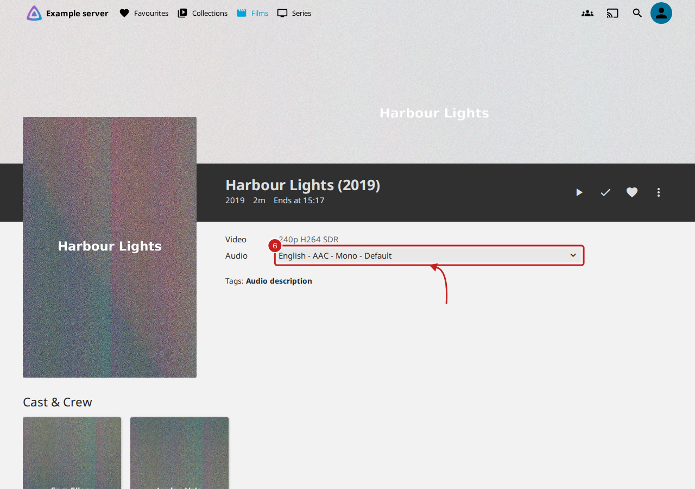

[Help centre](../README.md) · Audio description · how-to
<!-- help: plugins / audio-description -->

# Play the described track for the people who want it

Choose the people who want audio description, and when one of them starts a film or episode with a described track,
Jellyfin asks their app to change to it. In an app that does not accept that, they choose the track once in the
player, and Jellyfin can remember it. This takes 6 steps.

## Before you begin

- Audio description is installed. Read [Install Audio description](install.md).
- Each person who wants it has their own account in Jellyfin.

## Steps

1. Go to **Dashboard**, **Plugins**, **Installed**, select **Audio description**, then **Settings**.
2. Under **Play the described track**, tick each person who wants the described track, such as **Sam**. It is
   inactive for everyone until you tick someone.

   

3. Select **Save**, at the end of the page. The page says when it saved, such as "Saved at 16:31".

   

4. For each person you ticked: they sign in to Jellyfin and select their profile picture, then **Settings**, then
   **Playback**.
5. Under **Advanced**, they activate **Set audio track based on previous item**, then select **Save**. In a series,
   Jellyfin then plays each next episode with the sound track they chose for the last one, also in an app that does
   not change the track by itself.

   

6. To play a title with the described track in any app, they start it. If the app does not change the track, they
   choose the described track in **Audio** on the title's page, or in the player's sound track menu.

   

## How it works

When a person you ticked starts a film or episode with a described track, the plug-in waits 2 seconds for the app to
be ready. If the sound track playing is not the described one, it sends the app Jellyfin's own command to change the
sound track, the same command Jellyfin's apps send each other.

**Not every Jellyfin app accepts this.** Each app tells Jellyfin which commands it accepts. Jellyfin's web app is one
that accepts it. An app that does not say it does is left alone, and Jellyfin's log says so, with the app's name: "does
not accept the command to change the sound track". In those apps, the person chooses the described track in the
player.

## Things to note

- They can choose another sound track in the player as usual, each time.
- To stop it for someone, untick them and select **Save**.
- Only titles with a described track are changed. Read [Find the films and series with audio description](find-and-tag.md)
  for how a track is found.

## Find out more

- [Find the films and series with audio description](find-and-tag.md)
- [Audio description is not working](../fix/audio-description-problems.md)
- [Audio description's accessibility](../accessibility/audio-description.md)
