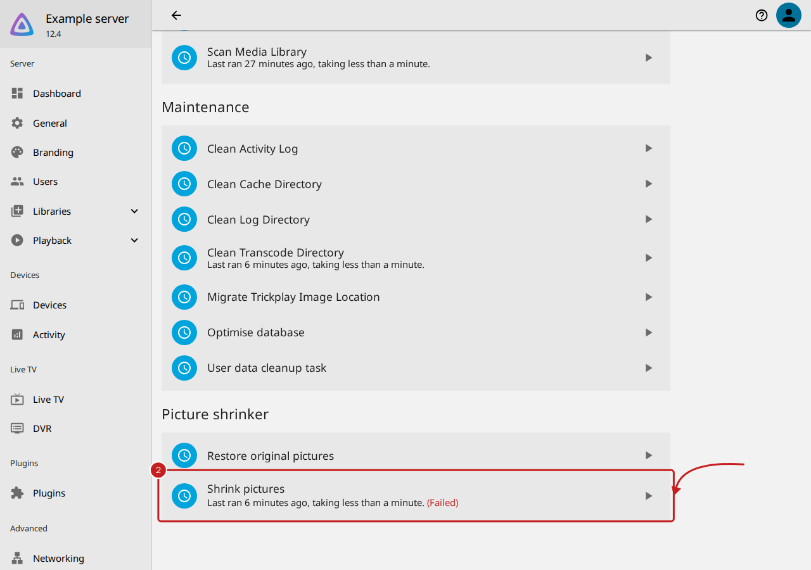
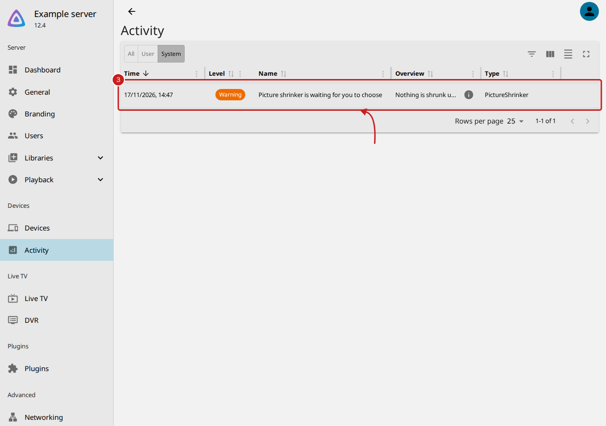

[Help centre](../README.md) · Picture shrinker · troubleshooting
<!-- help: fix / picture-shrinker -->

# Picture shrinker is not shrinking pictures

Picture shrinker runs, or should, but the pictures stay the same size, **Shrink pictures** shows as failed, or **Last
runs** says some were not shrunk. Follow the chart to find the cause.

```flow
title: Find your answer
start: The pictures are not shrunk
step: Open Scheduled Tasks | Dashboard, then Scheduled Tasks
q: What does Shrink pictures say?
  Failed -> 1
  It has not run yet -> 2
  It ran -> q2
q2: What does Last runs say?
  Some were not shrunk -> 3
  All were left as they were -> 4
  No pictures at all -> 5
1: Choose a backup option #1-choose-a-backup-option
2: Start a run #2-start-a-run
3: Give the backup room #3-give-the-backup-room
4: Check the sizes and the picture types #4-check-the-sizes-and-the-picture-types
5: Check where Jellyfin keeps the pictures #5-check-where-jellyfin-keeps-the-pictures
```

## 1. Choose a backup option

Nothing is shrunk until you choose a backup option, after you install Picture shrinker and after the update from
version 1.1. There is no default. Until you choose:

1. **Shrink pictures** ends as failed in **Scheduled Tasks**, with the reason: "Not shrunk: choose Keep a backup copy
   or Shrink without a backup, in its settings, first".
2. Go to **Dashboard**, then **Scheduled Tasks**: **Shrink pictures**, under **Picture shrinker**, says **(Failed)**.

   

3. Go to **Dashboard**, then **Activity**, and select **System**: "Picture shrinker is waiting for you to choose" is
   listed when Jellyfin starts, and again at most once a day when a run or a new picture is skipped.

   

4. To fix it, follow [Install Picture shrinker](../picture-shrinker/install.md), steps 11 to 13: under **Original
   pictures**, choose **Keep a backup copy of each original** or **Shrink without a backup**, then **Save**.
5. Select **Shrink now**, under **Space**, to shrink straight away.

## 2. Start a run

**Shrink pictures** runs every Sunday at 03:30 until you change it, so it may not have run yet.

1. Select **Shrink now**, under **Space** on the settings page, to run straight away.
2. If it never runs, check its triggers in **Scheduled Tasks**: a task with no trigger runs only when you start it.
   Read [Choose when Picture shrinker runs](../picture-shrinker/when-it-runs.md).
3. With **Once a month** active, a weekly trigger runs only the first time in each month.

## 3. Give the backup room

With **Keep a backup copy of each original**, a picture is not shrunk when its original cannot be copied first:

- **"the backup disk has only … free":** the backup disk would have less than 100 MB left. Free some space, or choose
  another **Backup folder** on a disk with room. The first run needs about as much free space as the pictures take
  now.
- **"the original could not be copied to the backup folder":** Jellyfin cannot write to the backup folder. Check that
  the folder exists and that the user Jellyfin runs as can write to it, such as the `PUID` of a LinuxServer.io
  container.

**Not shrunk**, under **Last runs**, counts these pictures. Each is left as it was, and the next run tries again.
A picture that cannot be read at all, such as a broken file, is counted there too and left alone.

## 4. Check the sizes and the picture types

**Left as they were** counts pictures already small enough: they are never made larger, and never written.

1. Check the sizes under **Sizes**: a picture is shrunk only when it is larger than its size.
2. Check that **Shrink all picture types** is active, or that the type is ticked under **Picture types**.
3. A picture already shrunk stays at its size when you raise the size: put the original back first.

Read [Choose which pictures to shrink, and their sizes](../picture-shrinker/choose-what-to-shrink.md).

## 5. Check where Jellyfin keeps the pictures

Picture shrinker works only in Jellyfin's metadata folder (`/config/metadata` in the official Docker image,
`/config/data/metadata` in the LinuxServer.io image).

- **Pictures saved beside your media files** are left alone. In a library's settings, **Save artwork into media
  folders** keeps them there.
- **A warning under Space**, such as "Jellyfin's metadata folder is not there", names the problem. "The backup folder
  must be a full path" or "cannot be inside the folders of pictures it shrinks" means **Backup folder** needs another
  path: read [Keep a backup, and put the original pictures back](../picture-shrinker/backup-and-restore.md).
- Only `.jpg`, `.jpeg`, `.png` and `.webp` pictures are shrunk, never hidden files.

## Other things that happen

- **The pictures are soft on a large television:** choose a larger size or a higher **Quality**.
- **Pictures came back full size:** **Refresh metadata** with **Replace existing images** downloads new pictures. The
  next run shrinks them.
- **A run stopped part way:** a run stops itself after 115 minutes, and the next run carries on.
- **Starboard's Picture shrinker says Idle:** that is expected while this one is installed. Read
  [Use the plug-ins with Starboard](../start/use-with-starboard.md).

## Find out more

- [Check how much space you saved](../picture-shrinker/space-saved.md)
- [Choose when Picture shrinker runs](../picture-shrinker/when-it-runs.md)
- [Install Picture shrinker](../picture-shrinker/install.md)
