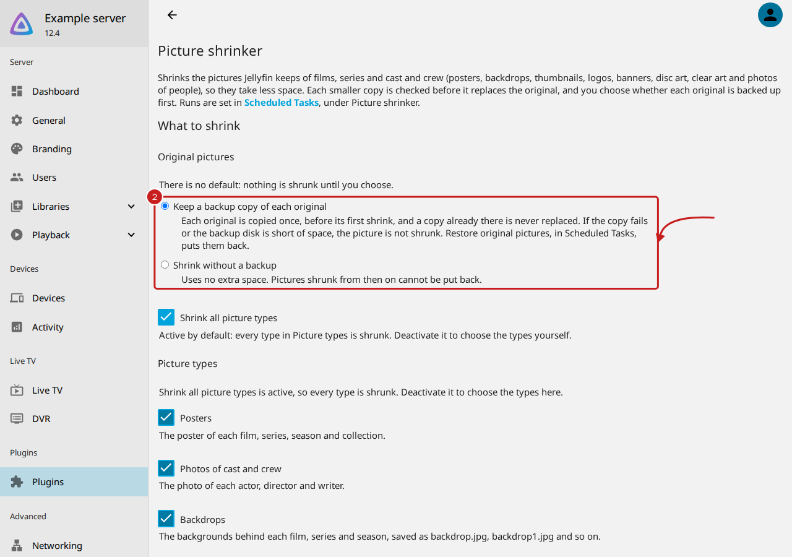
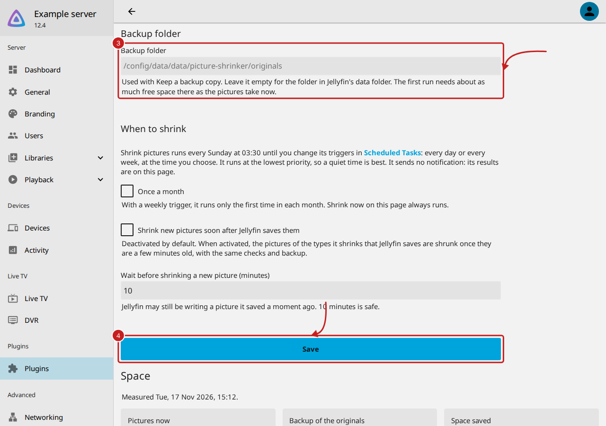
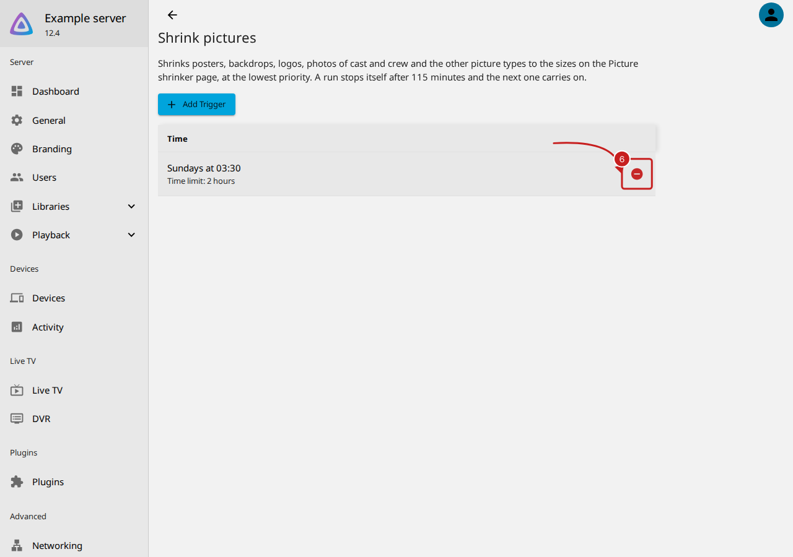
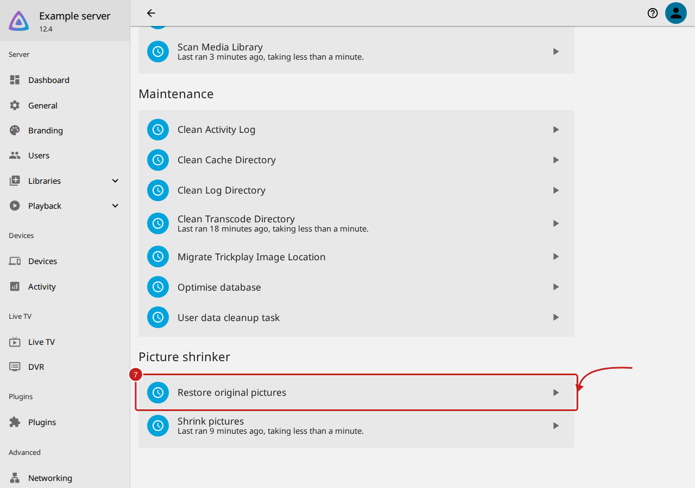
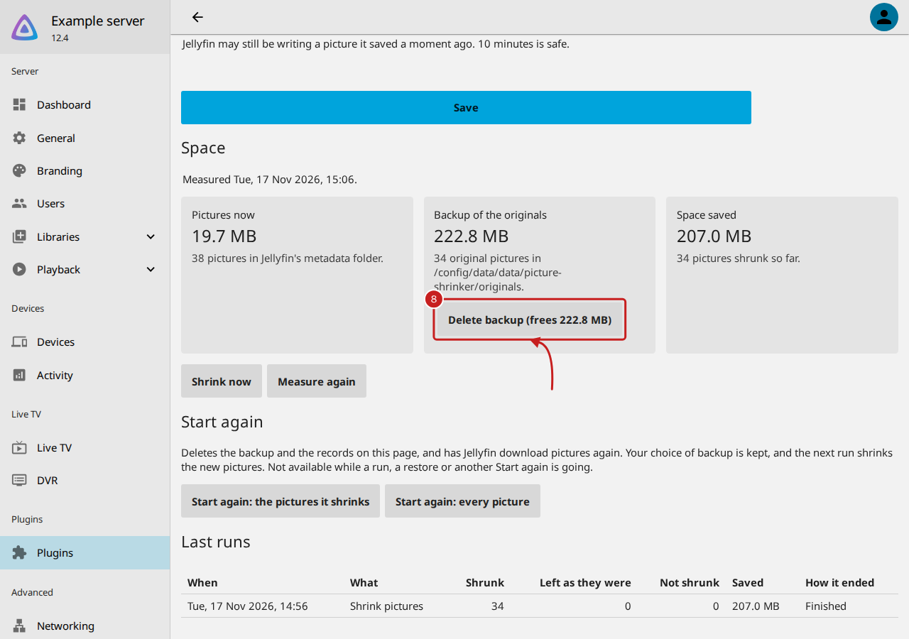
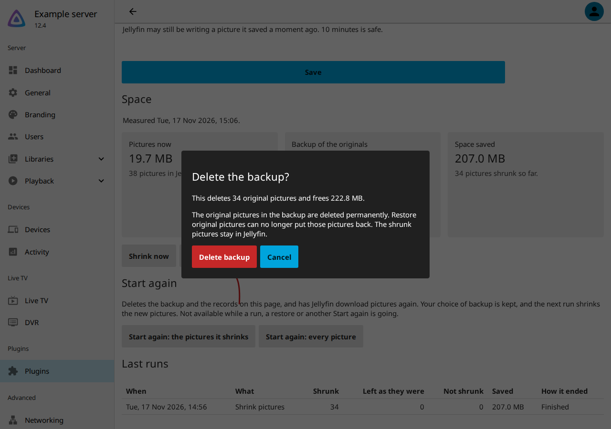

[Help centre](../README.md) · Picture shrinker · how-to
<!-- help: plugins / picture-shrinker -->

# Keep a backup, and put the original pictures back

With **Keep a backup copy of each original**, Picture shrinker copies each picture to a backup folder before it
shrinks it, so you can put every original back with one task. When you are happy with the smaller pictures,
**Delete backup** frees the space. This page has three tasks: choose the backup, put the originals back, and delete
the backup.

## Before you begin

- Picture shrinker is installed. Read [Install Picture shrinker](install.md).
- The first run with a backup needs about as much free space as the pictures take now. **Pictures now**, under
  **Space** on the settings page, says how much that is.

## Keep a backup

1. Go to **Dashboard**, **Plugins**, **Installed**, select **Picture shrinker**, then **Settings**.
2. Under **Original pictures**, choose **Keep a backup copy of each original**.

   

3. Optional: in **Backup folder**, enter a full path for the backup, such as `/backups/pictures`. Leave it empty for
   the folder in Jellyfin's data folder, `picture-shrinker/originals`. The folder cannot be inside the folders of
   pictures it shrinks.
4. Select **Save**.

   

From the next run, each original is copied once, before its first shrink, keeping its place under `library` or
`People`. A copy already in the backup is never replaced, so the backup always holds the first original. If the copy
fails, or the backup disk would have less than 100 MB free, the picture is not shrunk and the run says why.

## Put the original pictures back

**Restore original pictures** puts every original from the backup back where it came from, and keeps the backup. Stop
the schedule first, or the next run shrinks them again.

5. Go to **Dashboard**, then **Scheduled Tasks**, and select **Shrink pictures**, under **Picture shrinker**.
6. Select the delete button beside each trigger, such as **Sundays at 03:30**, until none is left.

   

7. Go back to **Scheduled Tasks** and select the run button beside **Restore original pictures**. A film or series may
   show the old picture until its page reloads.

   

Pictures put back no longer count in **Space saved**. Also deactivate **Shrink new pictures soon after Jellyfin saves
them**, if it is active: read [Choose when Picture shrinker runs](when-it-runs.md).

## Delete the backup

Delete the backup when you are happy with the smaller pictures. **Warning:** this cannot be undone. After it,
**Restore original pictures** can no longer put those pictures back. The shrunk pictures stay.

8. On Picture shrinker's settings page, under **Space**, select **Delete backup**. The button says how much space it
   frees, such as **Delete backup (frees 222.8 MB)**.

   

9. In **Delete the backup?**, select **Delete backup**. To keep it, select **Cancel**.

   

**Delete backup** removes only the pictures Picture shrinker put in the backup folder, never anything outside it, and
it is not available while a run is going.

## Things to note

- **Shrink without a backup** uses no extra space, and pictures shrunk from then on cannot be put back. Jellyfin can
  download them again from the internet with **Refresh metadata** or [Start again](start-again.md), but pictures you
  chose or uploaded yourself are lost. A backup you already have is kept until you delete it.
- **Refresh metadata** with **Replace existing images** fetches new, full-size pictures. The next run shrinks them,
  and the backup keeps the first original.
- The backup folder's place: `/config/data/picture-shrinker/originals` in the official Docker image,
  `/config/data/data/picture-shrinker/originals` in the LinuxServer.io image. **Backup of the originals**, under
  **Space**, names the folder it uses.

## Find out more

- [Start again with full-size pictures](start-again.md)
- [Check how much space you saved](space-saved.md)
- [Choose when Picture shrinker runs](when-it-runs.md)
