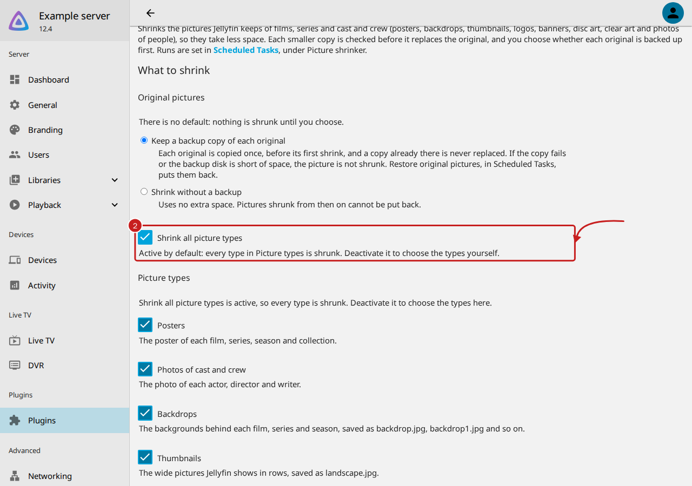
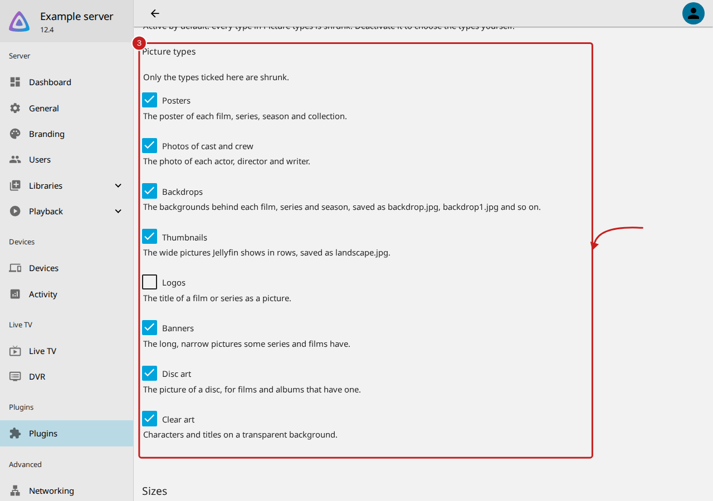
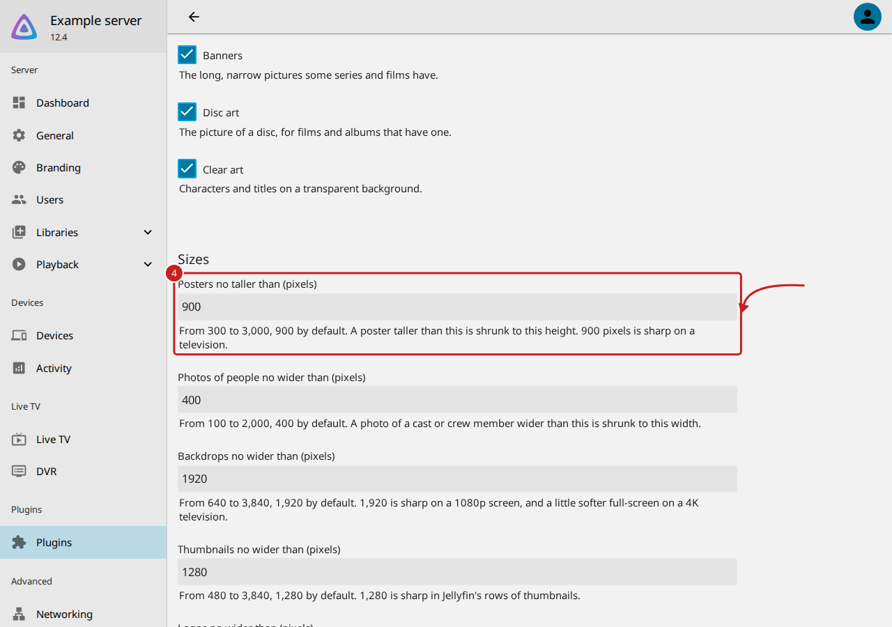
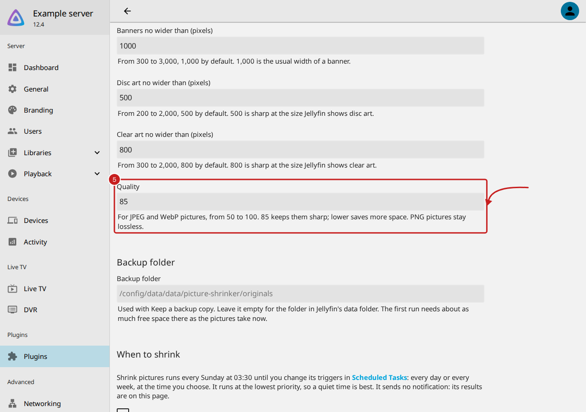
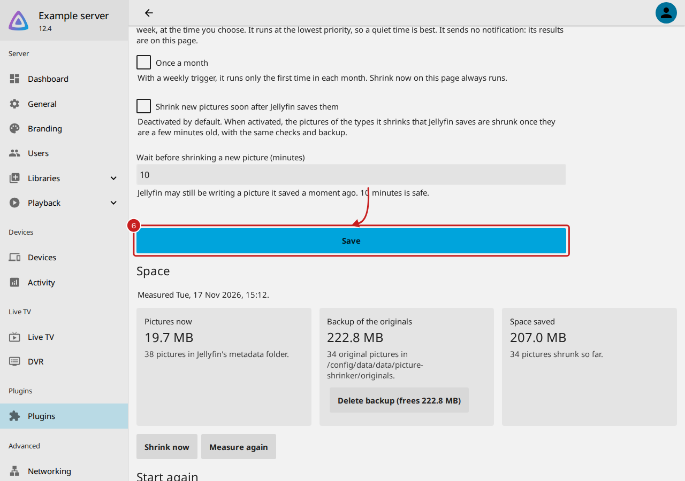

[Help centre](../README.md) · Picture shrinker · how-to
<!-- help: plugins / picture-shrinker -->

# Choose which pictures to shrink, and their sizes

Choose which kinds of picture Picture shrinker makes smaller, how large each may be, and the quality of the smaller
copies. Every picture type is shrunk by default, so change these only if you want something else. This takes 6
steps.

## Before you begin

- Picture shrinker is installed and a backup option is chosen. Read [Install Picture shrinker](install.md).

## Steps

1. Go to **Dashboard**, **Plugins**, **Installed**, select **Picture shrinker**, then **Settings**.
2. To choose the types yourself, deactivate **Shrink all picture types**, under **What to shrink**. While it is
   active, every type is shrunk and the ticks under **Picture types** cannot be changed.

   

3. Under **Picture types**, tick each type to shrink and untick the others. Each type is ticked by default.

   

4. Under **Sizes**, enter the largest size for each type, in pixels. A picture larger than this is shrunk to it; a
   smaller one is left as it is. The table under these steps has each size.

   

5. In **Quality**, enter a number from 50 to 100 for JPEG and WebP pictures. 85, the default, keeps them sharp; a lower
   number saves more space. PNG pictures stay lossless.

   

6. Select **Save**, at the end of the settings. The page says when it saved, such as "Saved at 16:31".

   

The next run uses the new choices. To run straight away, select **Shrink now** under **Space**.

## The sizes

| Picture type | Where Jellyfin keeps it | Setting | Default | From and to |
|---|---|---|---|---|
| Posters | `poster.*` under `library` | **Posters no taller than (pixels)** | 900 tall | 300 to 3,000 |
| Photos of cast and crew | Pictures under `People` | **Photos of people no wider than (pixels)** | 400 wide | 100 to 2,000 |
| Backdrops | `backdrop.*`, `backdrop1.*` and so on | **Backdrops no wider than (pixels)** | 1,920 wide | 640 to 3,840 |
| Thumbnails | `landscape.*` (Jellyfin's Thumb pictures) | **Thumbnails no wider than (pixels)** | 1,280 wide | 480 to 3,840 |
| Logos | `logo.*` | **Logos no wider than (pixels)** | 800 wide | 300 to 2,000 |
| Banners | `banner.*` | **Banners no wider than (pixels)** | 1,000 wide | 300 to 3,000 |
| Disc art | `disc.*` | **Disc art no wider than (pixels)** | 500 wide | 200 to 2,000 |
| Clear art | `clearart.*` | **Clear art no wider than (pixels)** | 800 wide | 300 to 2,000 |

- **Which pictures:** only the pictures in Jellyfin's metadata folder (`/config/metadata` in the official Docker image,
  `/config/data/metadata` in the LinuxServer.io image). Pictures saved beside your media files are left alone.
- **Which files:** only `.jpg`, `.jpeg`, `.png` and `.webp`, and never hidden files.
- **Formats:** each picture keeps its format. JPEG and WebP use **Quality**; PNG stays lossless and keeps its
  transparency, which matters for logos and clear art.
- **The checks:** each smaller copy is opened again and decoded in full, and replaces the original only when it has
  the right size and format and is smaller in bytes. If anything is wrong, the original stays as it was.

## Things to note

- **Smaller pictures are softer on very large televisions.** 900 pixels tall is sharp on a television; on a large 4K
  television up close, a poster can be a little soft. Choose a larger size, or a higher **Quality**, if that matters to you.
- **A picture already shrunk is not made larger again.** To use a larger size for pictures already shrunk, put the
  originals back first: read [Keep a backup, and put the original pictures back](backup-and-restore.md), or
  [Start again with full-size pictures](start-again.md).
- A type you untick keeps the pictures already shrunk as they are.

## Find out more

- [Choose when Picture shrinker runs](when-it-runs.md)
- [Check how much space you saved](space-saved.md)
- [Install Picture shrinker](install.md)
