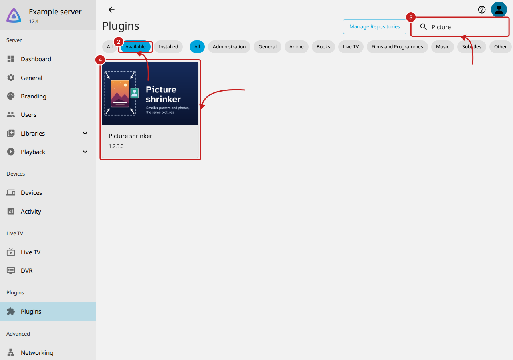
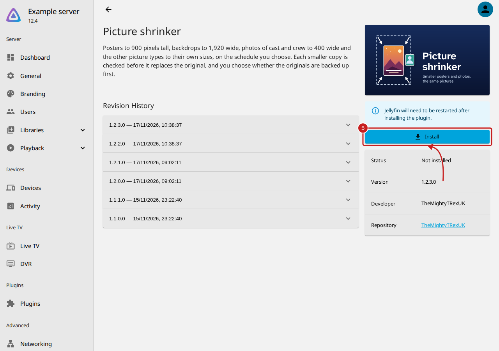
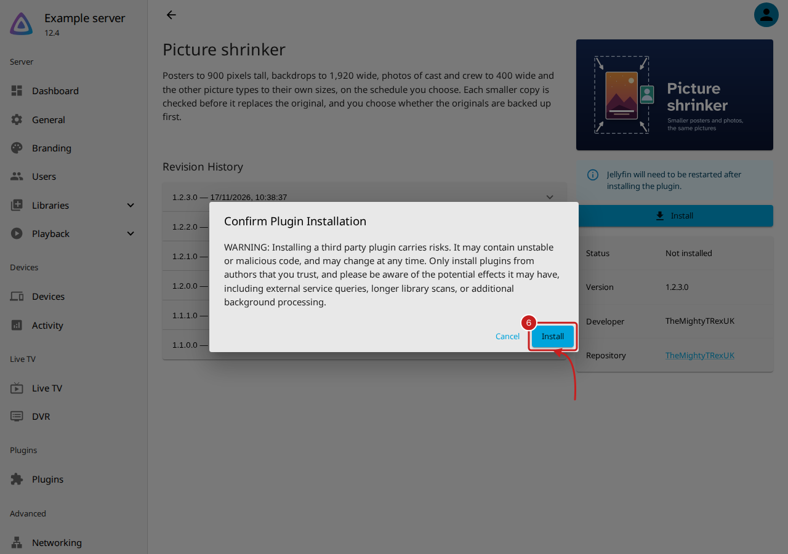
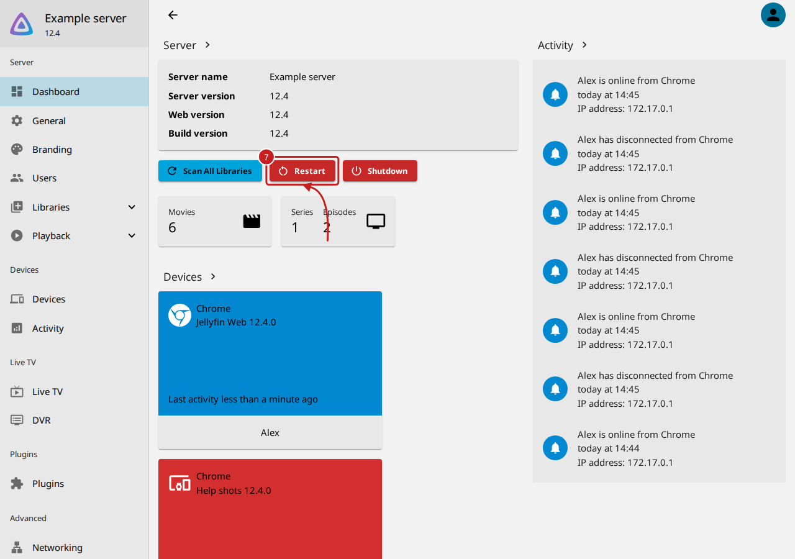
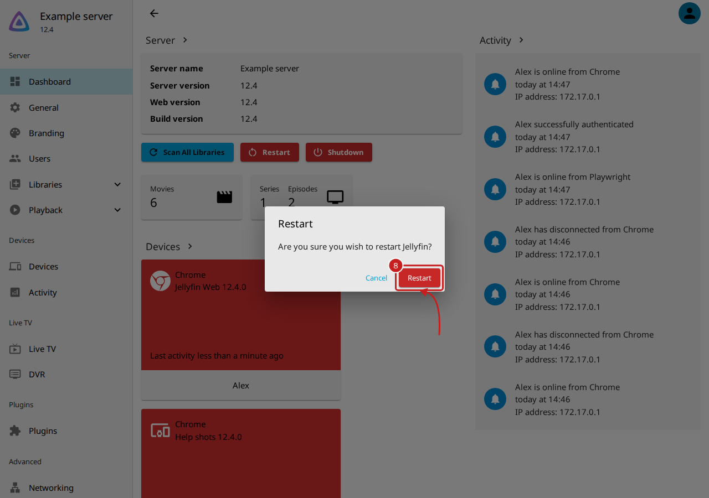
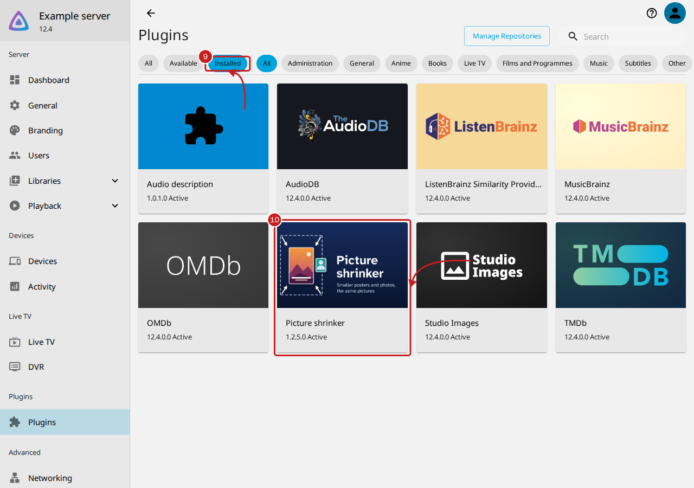
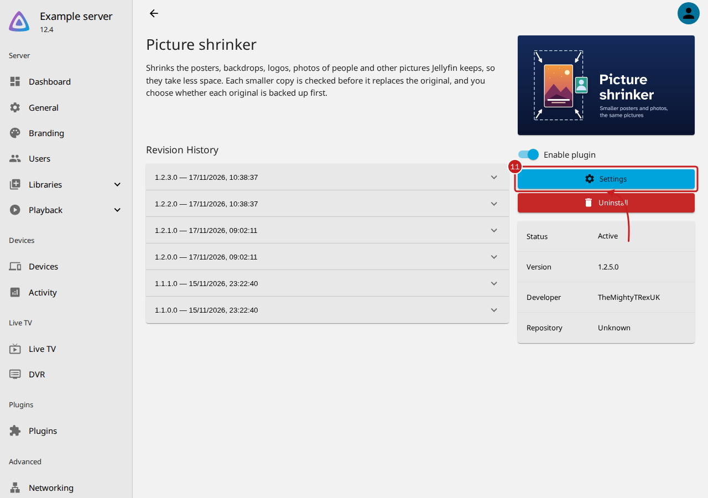
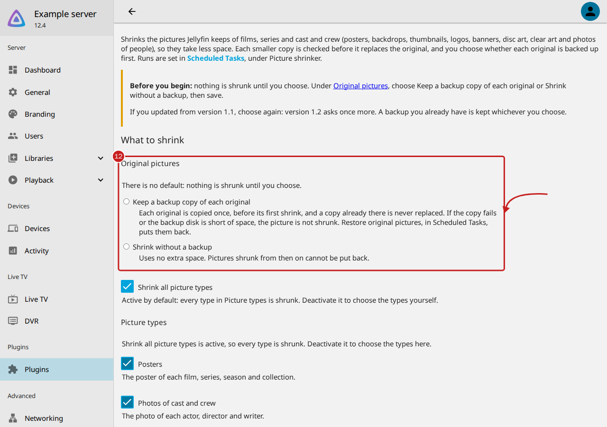
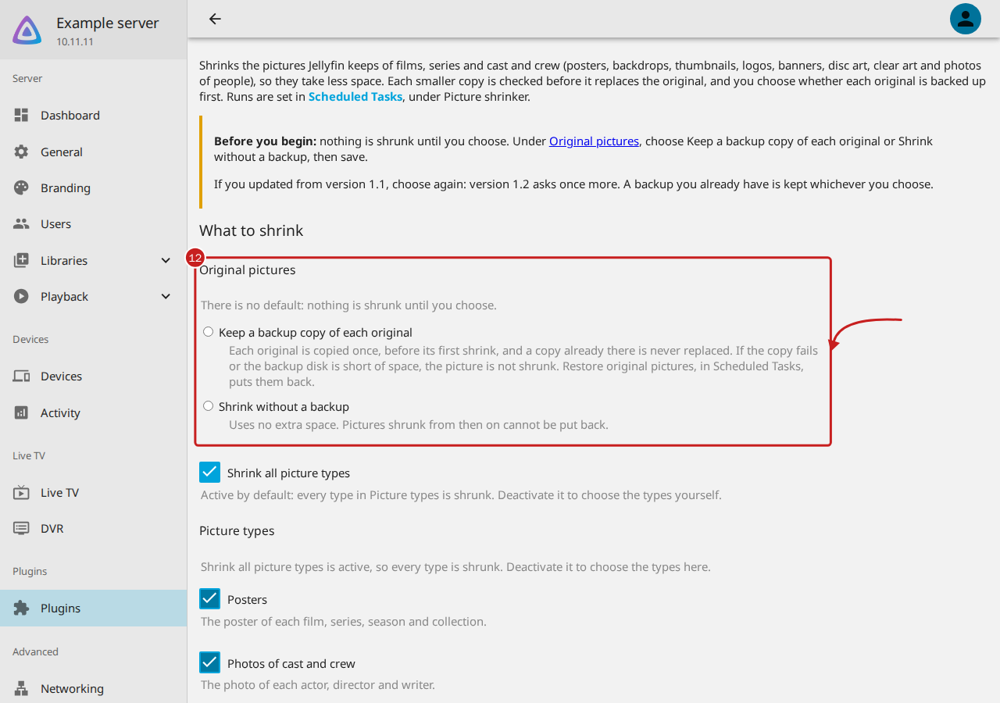
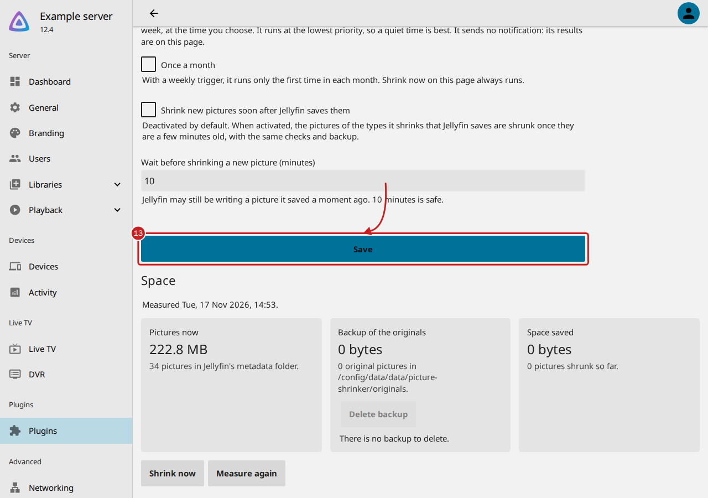

[Help centre](../README.md) · Picture shrinker · how-to
<!-- help: plugins / picture-shrinker -->

# Install Picture shrinker

Install Picture shrinker from Jellyfin's own catalogue, restart Jellyfin, then choose a backup option. Picture shrinker
makes the posters, backdrops, logos, photos of people and other pictures Jellyfin keeps smaller, so they take less
space. This takes 13 steps and about 5 minutes, with a restart.

> [!WARNING]
> **After you install or update it, choose a backup option, or nothing is shrunk.** There is no default. Until you
> choose, the Dashboard's 'Activity' list reminds you, and 'Shrink pictures' shows as failed in 'Scheduled Tasks'.
> Steps 11 to 13 make the choice.

## Before you begin

- The repository is in Jellyfin. Read [Add the repository to Jellyfin](../start/add-the-repository.md).
- An administrator account in Jellyfin 10.11 or Jellyfin 12. Jellyfin installs the build for its own version.
- Restarting Jellyfin stops anyone watching for about a minute: choose a quiet time.

## Steps

1. Go to **Dashboard**, then **Plugins**.
2. Select **Available**.
3. In **Search**, enter `Picture`.
4. Select the **Picture shrinker** card.

   

5. Select **Install**. Picture shrinker's page says what it does, and lists each version under **Revision History**.

   

6. In **Confirm Plugin Installation**, select **Install**.

   

7. Go to **Dashboard** and select **Restart**.

   

8. In the **Restart** dialog, select **Restart**. Jellyfin starts again in about a minute. If you run Jellyfin in
   Docker, you can restart its container instead.

   

9. When Jellyfin is back, go to **Dashboard**, then **Plugins**, and select **Installed**.
10. Select the **Picture shrinker** card. Its version and **Active** are under its name.

    

11. Select **Settings**. Picture shrinker's settings page opens, with a notice that nothing is shrunk until you choose.

    

12. Under **What to shrink**, then **Original pictures**, choose one:
    - **Keep a backup copy of each original:** each original is copied before its first shrink, so you can put it back.
      The first run needs about as much free space as the pictures take now.
    - **Shrink without a backup:** no extra space is used, and pictures shrunk from then on cannot be put back.

    

    The settings page is the same on Jellyfin 10.11, with the 10.11 build's version number.

    

13. Select **Save**, at the end of the settings. The page says when it saved, such as "Saved at 16:31".

    

Picture shrinker now runs every Sunday at 03:30. To shrink straight away, select **Shrink now** under **Space** on
the same page.

## Things to note

- Every picture type is shrunk by default, to the sizes in [Choose which pictures to shrink, and their sizes](choose-what-to-shrink.md).
- Its two tasks are in **Dashboard**, **Scheduled Tasks**, under **Picture shrinker**: **Shrink pictures** and
  **Restore original pictures**.
- Jellyfin 10.11.11 has the same pages and names. On a **Plugins** page with tabs, **Installed** is the **My Plugins**
  tab and **Available** is the **Catalogue** tab.
- If you use Starboard, it can do these steps for you: read [Use the plug-ins with Starboard](../start/use-with-starboard.md).

## Remove it

1. To put the original pictures back first, follow [Keep a backup, and put the original pictures back](backup-and-restore.md).
2. To free the backup's space, select **Delete backup** on the settings page.
3. Go to **Dashboard**, **Plugins**, **Installed**, select **Picture shrinker**, then **Uninstall**, and restart Jellyfin.

The pictures stay as they are. If you kept the backup, its folder stays in Jellyfin's data folder
(`picture-shrinker/originals`), with two small files of the plug-in's own: its settings,
`plugins/configurations/Jellyfin.Plugin.PictureShrinker.xml`, and its figures, `plugins/Jellyfin.Plugin.PictureShrinker`.
You can delete them yourself.

## If it does not work

- If Picture shrinker is not in **Available**, read [A plug-in is not in Jellyfin's catalogue](../fix/plug-in-not-in-the-catalogue.md).
- If nothing is shrunk, read [Picture shrinker is not shrinking pictures](../fix/picture-shrinker-problems.md).

## Find out more

- [Choose which pictures to shrink, and their sizes](choose-what-to-shrink.md)
- [Keep a backup, and put the original pictures back](backup-and-restore.md)
- [Choose when Picture shrinker runs](when-it-runs.md)
- [Picture shrinker's README on GitHub](../../picture-shrinker/README.md)
