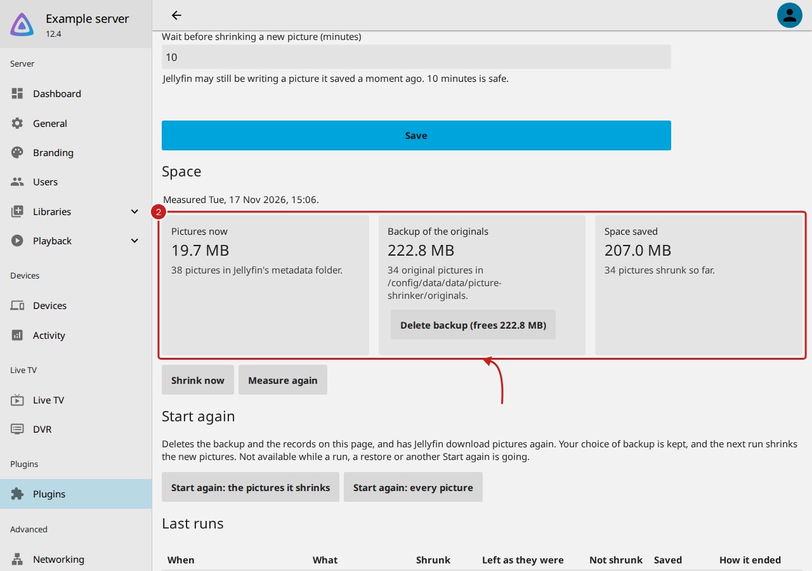
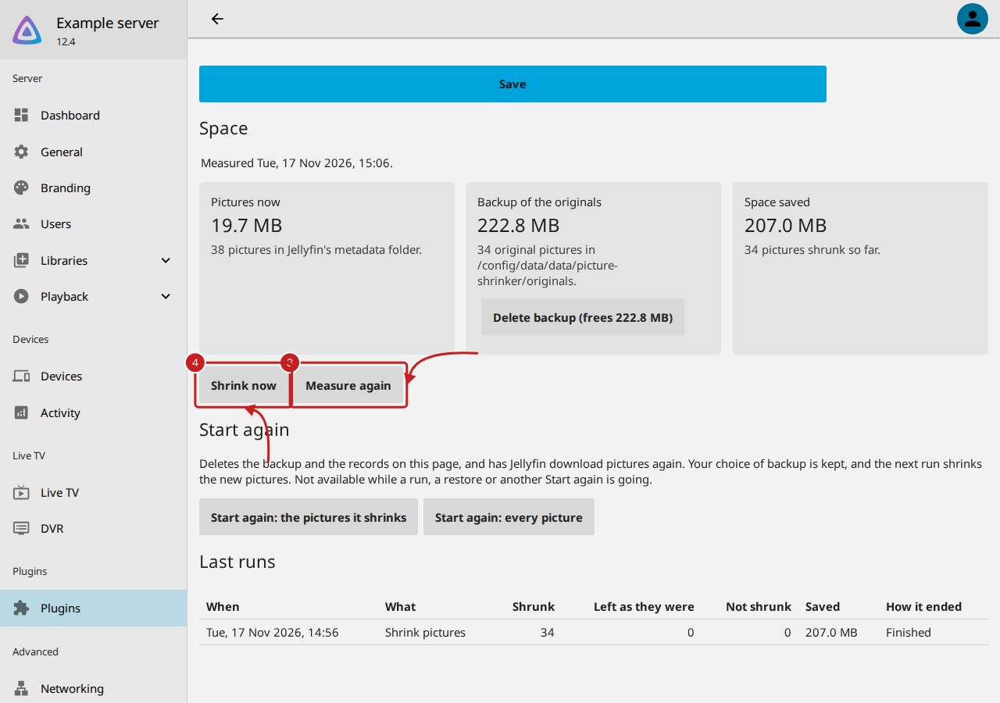
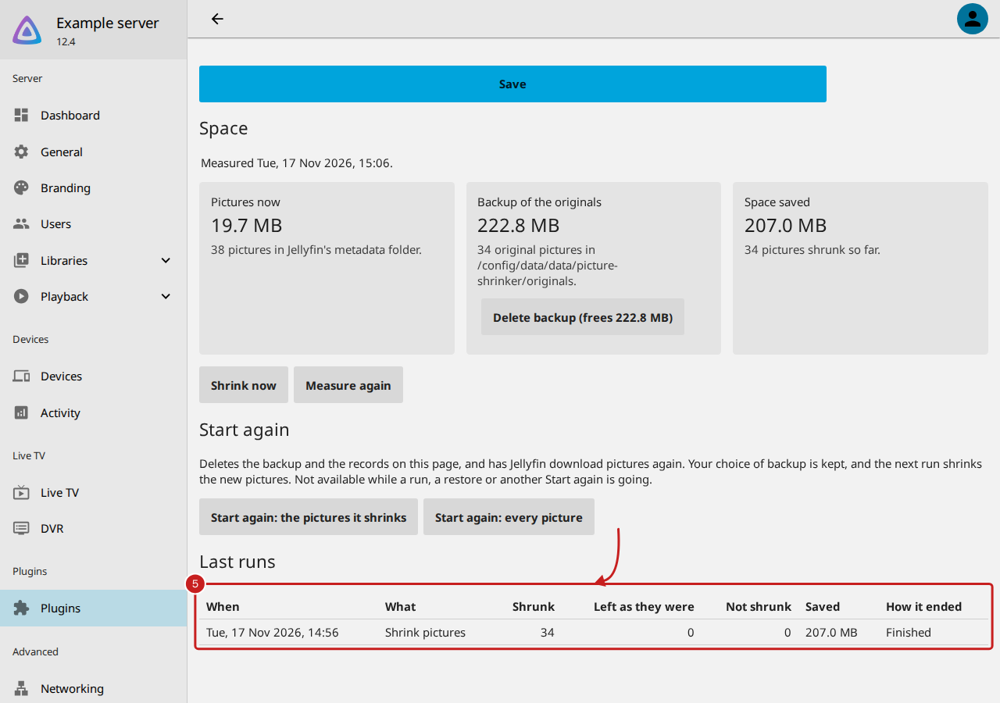

[Help centre](../README.md) · Picture shrinker · how-to
<!-- help: plugins / picture-shrinker -->

# Check how much space you saved

Picture shrinker's settings page shows how much space the pictures take now, how much the backup takes, and how much
space it has saved, with a list of its last runs. A run sends no notification, so this page is where its results are.
This takes 5 steps.

## Before you begin

- Picture shrinker is installed and a backup option is chosen. Read [Install Picture shrinker](install.md).

## Steps

1. Go to **Dashboard**, **Plugins**, **Installed**, select **Picture shrinker**, then **Settings**.
2. Under **Space**, read the three figures. They are measured when the page opens and after each thing you do on it;
   **Measured** says when.
   - **Pictures now:** the size and number of the pictures of the types it shrinks, in Jellyfin's metadata folder.
   - **Backup of the originals:** the size and number of pictures in the backup, and the folder it is in, with
     **Delete backup** and the space it frees.
   - **Space saved:** the space saved now and how many pictures are shrunk. After [Start again](start-again.md), it
     also says how many pictures are waiting for Jellyfin, replaced by a new one and put back.

   

3. Select **Measure again** to measure now, such as while a run is going.
4. To shrink straight away, select **Shrink now**. It runs at the lowest priority; **Scheduled Tasks** shows how far
   it has gone.

   

5. Under **Last runs**, read each run: **When**, **What** started it, how many were **Shrunk**, **Left as they were**
   and **Not shrunk**, the space **Saved**, and **How it ended**.

   

## What the figures mean

- **Left as they were:** pictures already small enough. They are only opened to read their size, never written.
- **Not shrunk:** pictures that could not be read, or whose original could not be copied to the backup. Each is left
  as it was. Read [Picture shrinker is not shrinking pictures](../fix/picture-shrinker-problems.md).
- **How it ended:** **Finished**, or why it stopped, such as "Stopped at its time limit; the next run carries on"
  after 115 minutes, or "Stopped by you; the next run carries on".
- **Pictures put back** by **Restore original pictures** no longer count in **Space saved**.
- A picture is counted once, however many times it is opened.

## Example: what to expect

On a sample of 540 made-up pictures (300 posters at 2,000 by 3,000 pixels and 240 photos at 1,365 by 2,048), the
pictures went from 776.3 MB to 17.5 MB, saving 758.8 MB, in 55 seconds. Real libraries vary with the pictures their
metadata source gives.

## Find out more

- [Choose when Picture shrinker runs](when-it-runs.md)
- [Keep a backup, and put the original pictures back](backup-and-restore.md)
- [Choose which pictures to shrink, and their sizes](choose-what-to-shrink.md)
