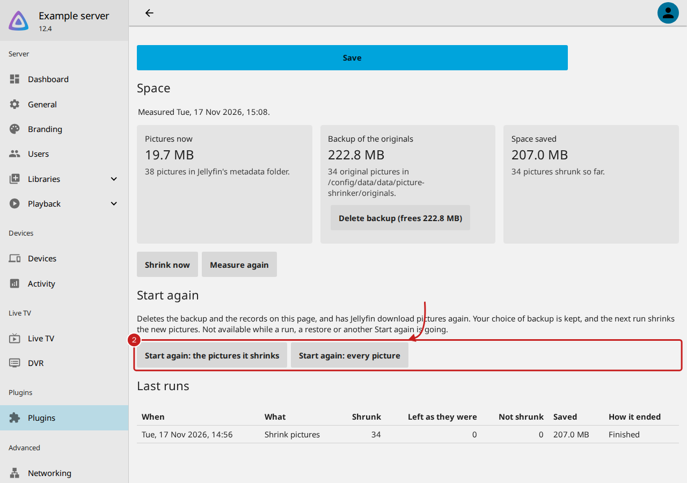
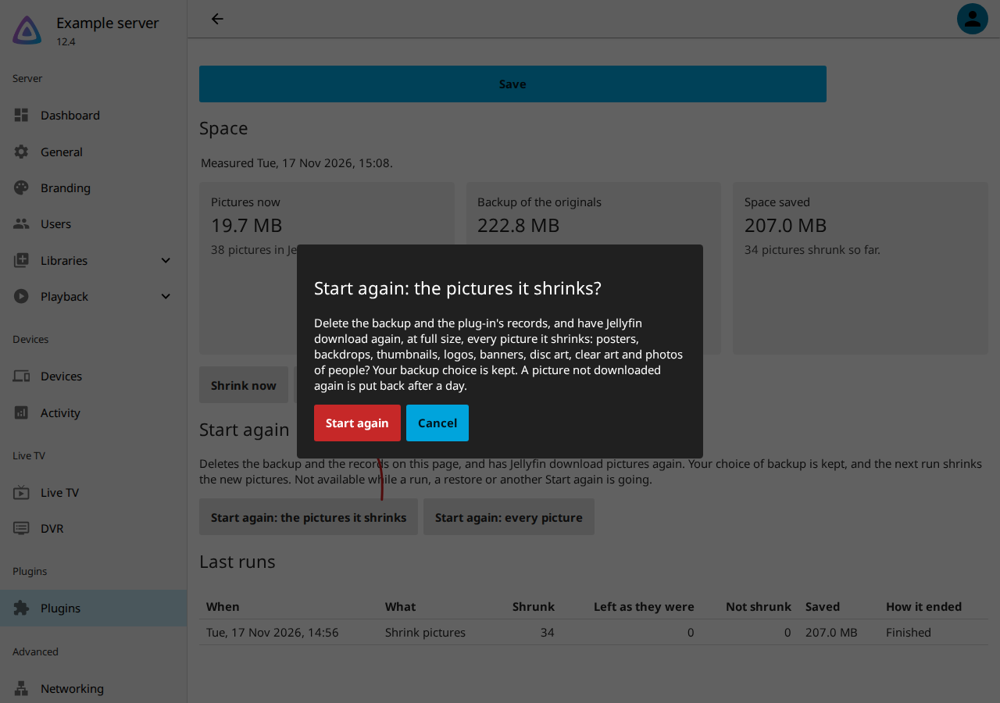
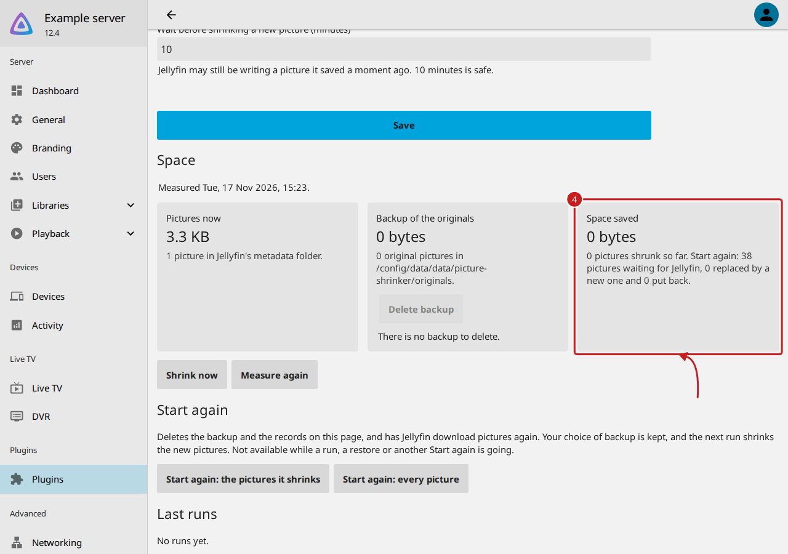

[Help centre](../README.md) · Picture shrinker · how-to
<!-- help: plugins / picture-shrinker -->

# Start again with full-size pictures

**Start again** clears everything Picture shrinker has done and has Jellyfin download the pictures again from the
internet, at full size. Use it to shrink again at new sizes, or to go back to full-size pictures when there is no
backup. There are two kinds, and each asks you first. This takes 4 steps; Jellyfin's downloads can take some hours.

## Before you begin

- Picture shrinker is installed. Read [Install Picture shrinker](install.md).
- Jellyfin can reach the internet, and your libraries download pictures from a metadata source, such as TMDb.
- Nothing else of Picture shrinker's is going: a run, a restore or another Start again. Start again is not available
  until it has finished.

## Steps

1. Go to **Dashboard**, **Plugins**, **Installed**, select **Picture shrinker**, then **Settings**.
2. Under **Start again**, select one:
   - **Start again: the pictures it shrinks:** Jellyfin downloads again every picture of the types Picture shrinker
     shrinks, whatever is ticked in **What to shrink**.
   - **Start again: every picture:** Jellyfin replaces every picture of every film, series, season, collection and
     person, backdrops and logos included. Pictures you added yourself in Jellyfin are replaced. This downloads much
     more and can take many hours.

   

3. Read the question, then select **Start again**. To stop, select **Cancel**: nothing changes.

   

4. Under **Space**, **Space saved** says how many pictures are waiting for Jellyfin, how many were replaced by a new
   one and how many were put back. Select **Measure again** to bring the figures up to date.

   

The next run shrinks the new pictures, backing them up first if **Keep a backup copy of each original** is chosen.

## What Start again does

In this order:

1. It deletes the backup, with the same safe rules as **Delete backup**.
2. It clears the records on the settings page: the last runs, the space saved and the failures. Your choice of backup
   is kept.
3. It asks Jellyfin to download the pictures again, as refreshes in Jellyfin's own queue at low priority, with a short
   pause between them, so Jellyfin and the server are not flooded:
   - **The pictures it shrinks:** each picture is moved aside to a hidden file in the same folder, such as
     `.poster.jpg.picture-shrinker-old`, and Jellyfin refreshes the film, series, season, collection or person it
     belongs to. It downloads only the missing picture, at full size, and fills in metadata only where it is missing.
   - **Every picture:** nothing is moved. Jellyfin refreshes each library, with everything in it, and each person,
     replacing every picture.

## Things to note

- **Nothing is lost while Jellyfin downloads.** The old picture is kept until Jellyfin has a new one. Every 10 minutes
  while any are waiting, and at the start of each run, Picture shrinker checks them: once Jellyfin has saved a new
  picture, the old one is deleted; after 24 hours with none, the old one is put back under its own name. So a poster
  you uploaded yourself, or one no source has, comes back.
- The list of waiting pictures is kept in the plug-in's figures, so it carries on after a restart.
- **Restore original pictures**, **Delete backup** and Start again still work before you choose a backup option.

## Find out more

- [Keep a backup, and put the original pictures back](backup-and-restore.md)
- [Choose which pictures to shrink, and their sizes](choose-what-to-shrink.md)
- [Check how much space you saved](space-saved.md)
