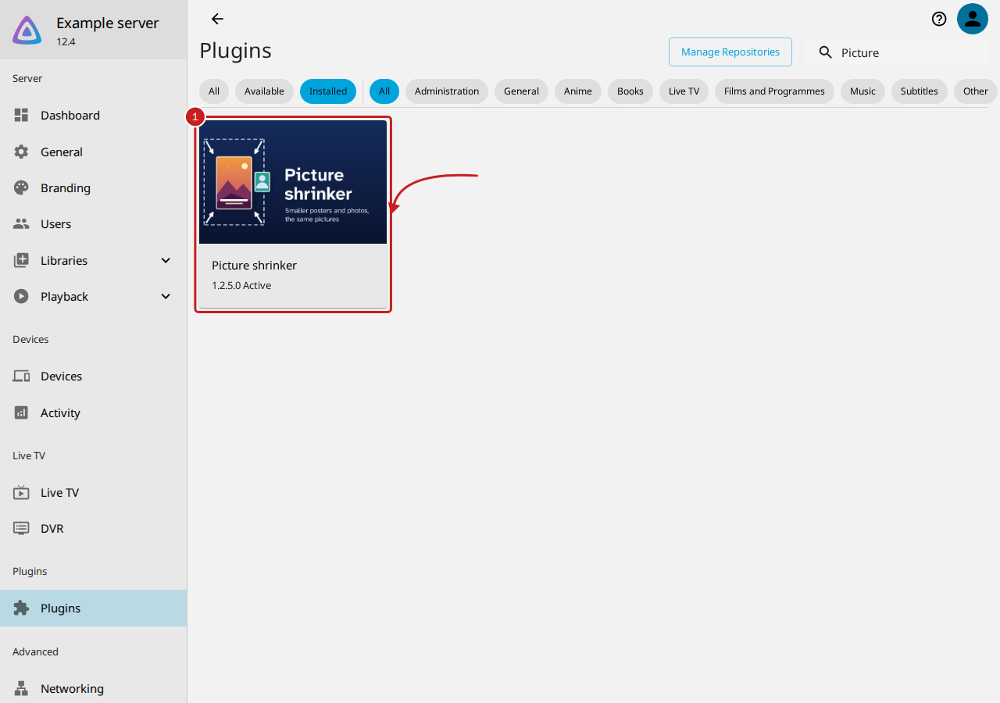
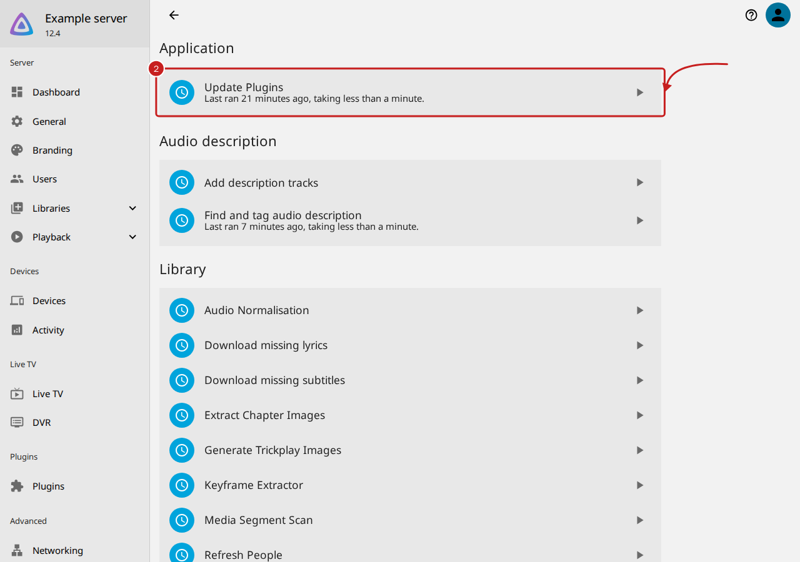
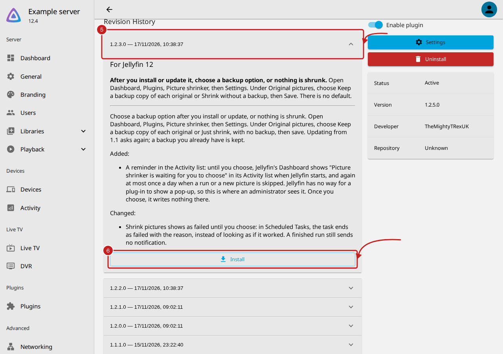

[Help centre](../README.md) · Picture shrinker · how-to
<!-- help: plugins / picture-shrinker -->

# Update Picture shrinker, or go back to an earlier version

Jellyfin installs new versions of Picture shrinker by itself, from the repository, with its **Update Plugins** task.
You can also check for an update straight away, or go back to an earlier version from **Revision History**. Each
needs a restart of Jellyfin. This takes 7 steps.

## Before you begin

- Picture shrinker is installed from the repository. Read [Install Picture shrinker](install.md).
- Restarting Jellyfin stops anyone watching for about a minute: choose a quiet time.

## Update

1. Go to **Dashboard**, **Plugins**, then **Installed**. Picture shrinker's card shows the version you have, such as
   1.2.5.0.

   

2. To check for an update now, go to **Dashboard**, then **Scheduled Tasks**, and select the run button beside
   **Update Plugins**, under **Application**. Jellyfin also runs it by itself.

   

3. Restart Jellyfin: go to **Dashboard**, select **Restart**, then **Restart** again. The new version is used from
   the restart.

## Go back to an earlier version

4. Go to **Dashboard**, **Plugins**, **Installed**, and select **Picture shrinker**.
5. Under **Revision History**, select the version to go back to, such as **1.2.3.0**. Its notes open.
6. Select **Install**, under its notes.

   

7. Restart Jellyfin.

**Update Plugins** installs the newest version again when it next runs. To stay on the earlier version, remove the
triggers of **Update Plugins** in **Scheduled Tasks**: this stops updates for every plug-in, so add them back later.

## Things to note

- **After an update, check Original pictures.** The update from version 1.1 to 1.2 asks you to choose a backup option
  again, and nothing is shrunk until you do. A backup folder you already have is kept. Read
  [Install Picture shrinker](install.md), steps 11 to 13.
- **Each version has two builds.** The third number says which: even for Jellyfin 10.11, odd for Jellyfin 12, such
  as 1.2.4.0 and 1.2.5.0. Jellyfin installs the build for its own version, so the list shows both.
- **The notes in Revision History** start with which Jellyfin the build is for, then any warning, then what changed.
- **A label that changed:** in version 1.2.3.0 and earlier, **Shrink without a backup** was called **Just shrink, with
  no backup**. A choice you made is kept.
- **Going back to 1.1** loses the choice of backup and the picture types other than posters and photos of people,
  which 1.2 added. Pictures already shrunk stay shrunk.

## The versions

| Version for Jellyfin 12 | Version for Jellyfin 10.11 | What it brought |
|---|---|---|
| 1.2.5.0 | 1.2.4.0 | Clearer wording, the time of the last save, and **Shrink without a backup** as the new name |
| 1.2.3.0 | 1.2.2.0 | A reminder in the **Activity** list until you choose a backup option; **Shrink pictures** fails until you choose |
| 1.2.1.0 | 1.2.0.0 | Every picture type, the choice of backup, and **Start again** |
| 1.1.1.0 | 1.1.0.0 | The first version: posters and photos of people, with a backup |

The full notes are in [Picture shrinker's CHANGELOG.md](../../picture-shrinker/CHANGELOG.md).

## If it does not work

- If the newer version does not appear, read [A plug-in is not in Jellyfin's catalogue](../fix/plug-in-not-in-the-catalogue.md):
  the same causes apply.
- If you added Picture shrinker's first address, new versions are listed only at the new one. Read
  [Move from the old Picture shrinker address](../start/move-from-the-old-address.md).

## Find out more

- [Install Picture shrinker](install.md)
- [Move from the old Picture shrinker address](../start/move-from-the-old-address.md)
- [Picture shrinker for developers: the rules and SYNC.md](../developers/picture-shrinker.md)
