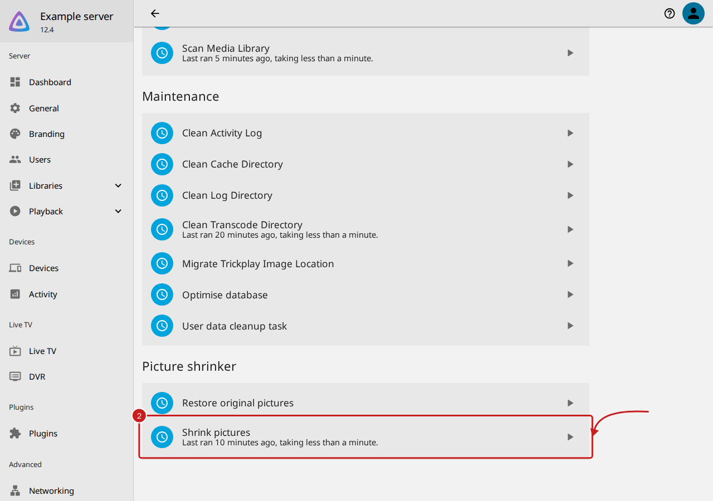
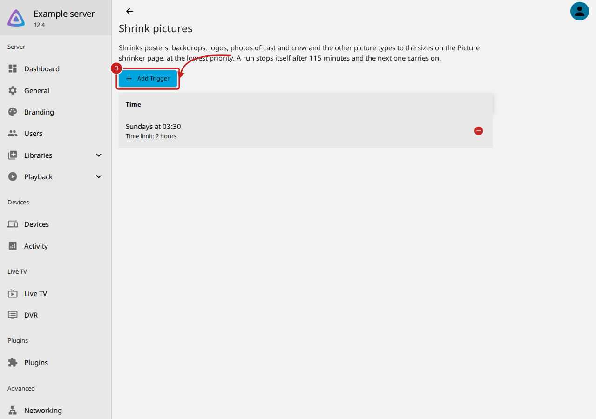
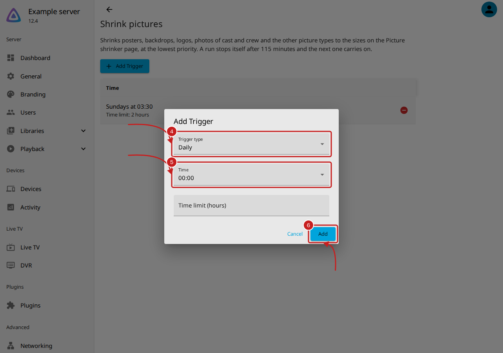
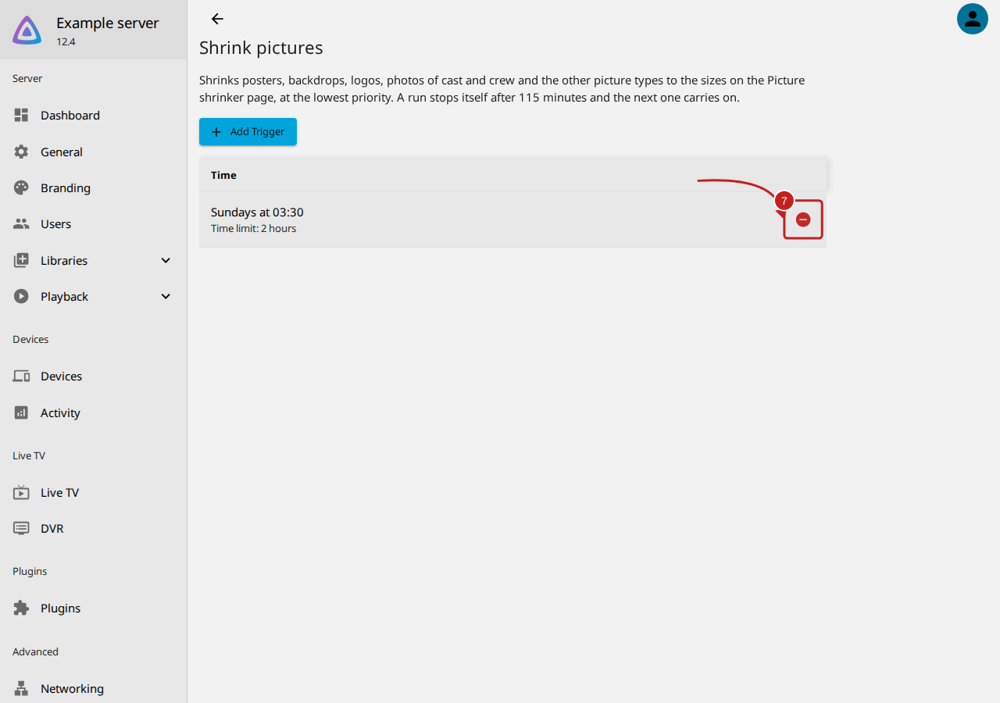
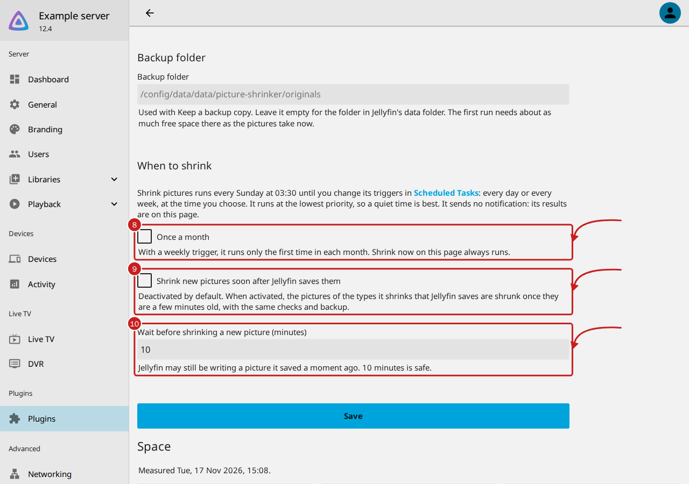

[Help centre](../README.md) · Picture shrinker · how-to
<!-- help: plugins / picture-shrinker -->

# Choose when Picture shrinker runs

**Shrink pictures** is a task in Jellyfin's **Scheduled Tasks**, and it runs every Sunday at 03:30 until you change
it. Change its time with Jellyfin's own triggers, and choose on the settings page whether it runs once a month and
whether new pictures are shrunk soon after Jellyfin saves them. This takes 11 steps.

## Before you begin

- Picture shrinker is installed and a backup option is chosen. Read [Install Picture shrinker](install.md).
- Choose a quiet time, such as the night. A run works at the lowest priority, so people can watch while it runs, but
  on a small server it still uses processor time.

## Change the time

1. Go to **Dashboard**, then **Scheduled Tasks**.
2. Under **Picture shrinker**, select **Shrink pictures**.

   

3. Select **Add Trigger**.

   

4. In **Trigger type**, choose **Daily** or **Weekly**. For **Weekly**, also choose the day.
5. In **Time**, choose the time to start.
6. Select **Add**.

   

7. To remove the old time, select the delete button beside **Sundays at 03:30**.

   

## Once a month, and new pictures

8. Go to **Dashboard**, **Plugins**, **Installed**, select **Picture shrinker**, then **Settings**. Under **When to
   shrink**, activate **Once a month** to make a weekly trigger run only the first time in each month.
9. Activate **Shrink new pictures soon after Jellyfin saves them** to shrink the pictures Jellyfin saves for new films,
   series and people, without waiting for the next run. It is inactive by default.
10. In **Wait before shrinking a new picture (minutes)**, enter how long to wait, from 1 to 1,440. Jellyfin may still
    be writing a picture it saved a moment ago: 10 minutes, the default, is safe.

    

11. Select **Save**.

## How a run works

- **Shrink now**, under **Space** on the settings page, or the run button beside **Shrink pictures** in **Scheduled
  Tasks**, starts a run straight away. **Once a month** never stops these.
- **To stop a run**, use the stop button in **Scheduled Tasks**. It stops after the picture it is on.
- **A run stops itself after 115 minutes**, and the next run carries on. Pictures already shrunk are only opened to
  read their size, never written.
- **It works at the lowest priority** for the processor and the disk, so people can watch while it runs.
- **It sends no notification.** Its results are the figures on the settings page: read
  [Check how much space you saved](space-saved.md). Jellyfin's own **Scheduled Tasks** keeps its usual history.
- **Until you choose a backup option, nothing is shrunk:** **Shrink pictures** ends as failed, with the reason.

## Find out more

- [Check how much space you saved](space-saved.md)
- [Choose which pictures to shrink, and their sizes](choose-what-to-shrink.md)
- [Picture shrinker is not shrinking pictures](../fix/picture-shrinker-problems.md)
