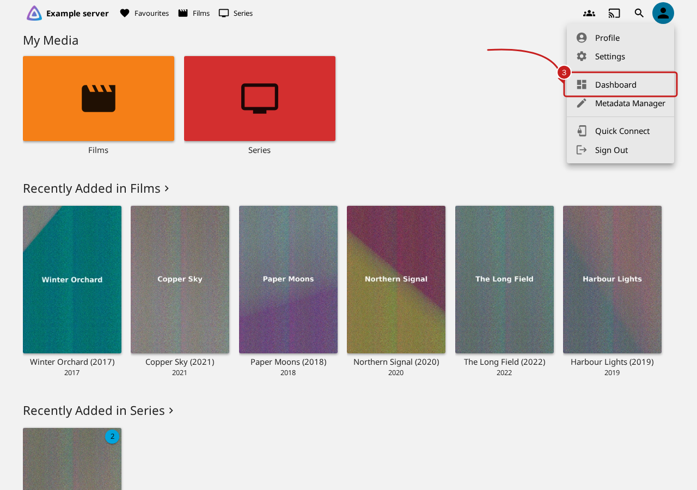
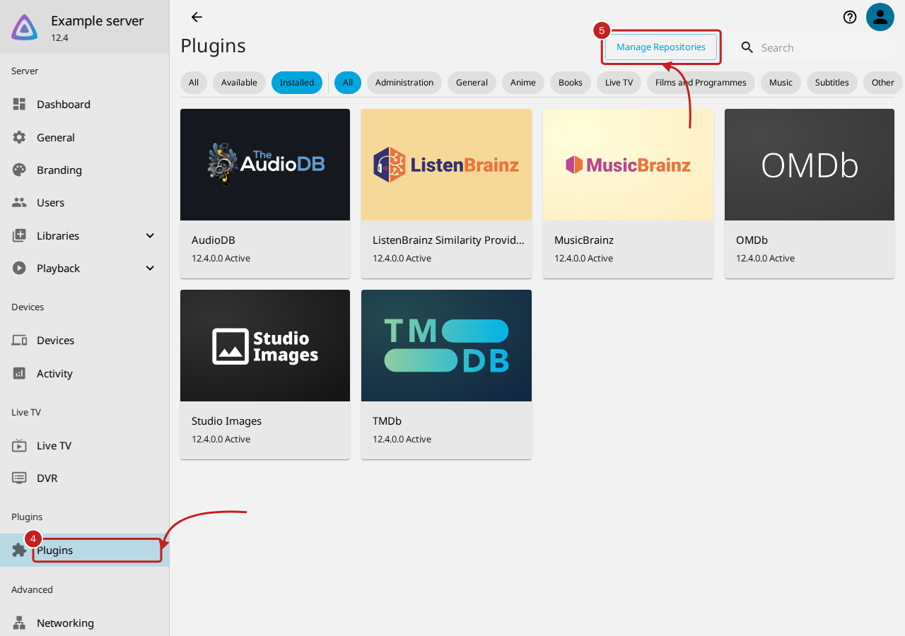
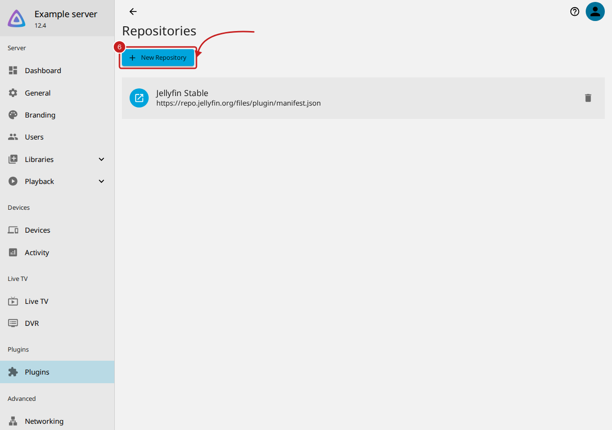
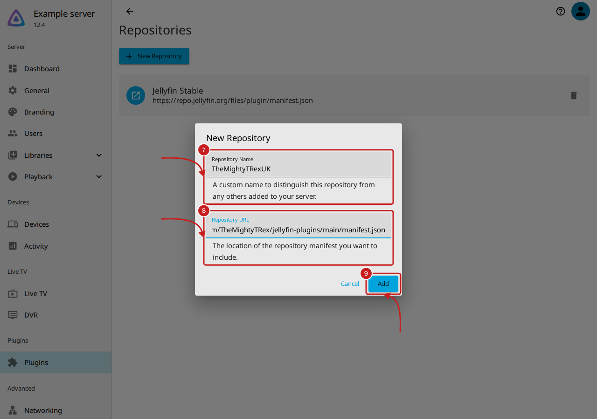
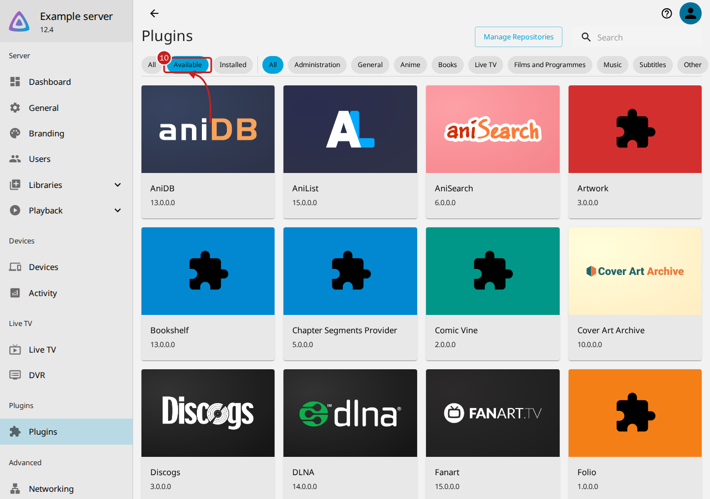
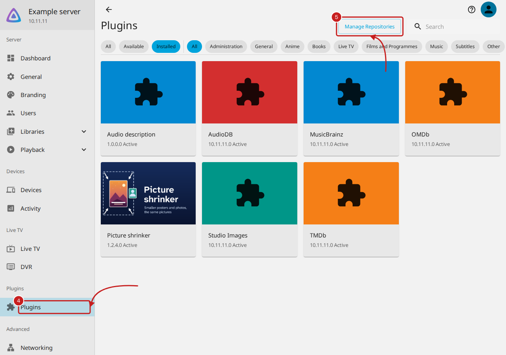
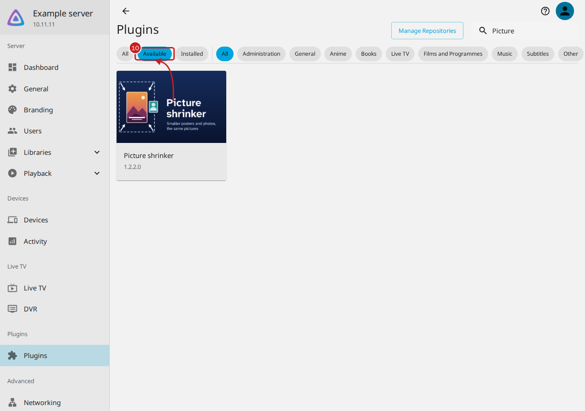

[Help centre](../README.md) · Add the plug-ins · how-to
<!-- help: start / add -->

# Add the repository to Jellyfin

Add one repository address to Jellyfin, and every plug-in by TheMightyTRexUK appears in Jellyfin's catalogue, with its
updates. A repository is a list of plug-ins that Jellyfin reads from the internet. This takes 10 steps and about 2
minutes.

The address is:

```text
https://raw.githubusercontent.com/TheMightyTRex/jellyfin-plugins/main/manifest.json
```

## Before you begin

- Jellyfin 10.11 or Jellyfin 12, and an administrator account. To find your version, go to **Dashboard**: the version
  is under the server name in the Dashboard's menu.
- If you added Picture shrinker's first address before, read
  [Move from the old Picture shrinker address](move-from-the-old-address.md) instead.

These steps are for Jellyfin 12 and Jellyfin 10.11.11, which have the same pages and names. An earlier Jellyfin 10.11
with tabs on its **Plugins** page names some controls differently: read [On Jellyfin 10.11](#on-jellyfin-1011).

## Steps

1. Open Jellyfin in a web browser and sign in with an administrator account.
2. Select your profile picture, in Jellyfin's header.
3. Select **Dashboard**.

   

4. In the Dashboard's menu, under **Plugins**, select **Plugins**.
5. Select **Manage Repositories**. The **Repositories** page opens, listing **Jellyfin Stable**.

   

6. Select **New Repository**. The **New Repository** dialog opens.

   

7. In **Repository Name**, enter `TheMightyTRexUK`. Any name works: it is only for you.
8. In **Repository URL**, paste the address:
   `https://raw.githubusercontent.com/TheMightyTRex/jellyfin-plugins/main/manifest.json`
9. Select **Add**. The repository is listed under **Jellyfin Stable**.

   

10. Go back to **Plugins** and select **Available**. Picture shrinker is listed with its own picture. Audio
    description is listed once it is released.

    

Now install the plug-ins you want: read [Install Picture shrinker](../picture-shrinker/install.md) and
[Install Audio description](../audio-description/install.md).

## On Jellyfin 10.11

Jellyfin 10.11.11 has the same **Plugins** page as Jellyfin 12, so the steps are the same. It lists the build for
Jellyfin 10.11, such as Picture shrinker 1.2.2.0.





If your **Plugins** page has tabs instead, use these names:

| Step | Jellyfin 12 and 10.11.11 | A Plugins page with tabs |
|---|---|---|
| 5 | **Manage Repositories** | The **Repositories** tab |
| 6 | **New Repository** | **+** |
| 9 | **Add** | **Save** |
| 10 | **Available** | The **Catalogue** tab |

## Things to note

- Each plug-in has two builds, one for Jellyfin 12 and one for Jellyfin 10.11. Jellyfin installs the one for its own
  version, so the catalogue shows a different version number on each.
- Jellyfin reads the repository again each time it checks for updates, so new versions appear by themselves.
- You need Starboard for neither plug-in. If you use Starboard, read
  [Use the plug-ins with Starboard](use-with-starboard.md).

## If it does not work

If the plug-ins are not in **Available**, read [A plug-in is not in Jellyfin's catalogue](../fix/plug-in-not-in-the-catalogue.md).

## Find out more

- [Install Picture shrinker](../picture-shrinker/install.md)
- [Install Audio description](../audio-description/install.md)
- [Move from the old Picture shrinker address](move-from-the-old-address.md)
- [Use the plug-ins with Starboard](use-with-starboard.md)
- [The repository on GitHub](https://github.com/TheMightyTRex/jellyfin-plugins)
