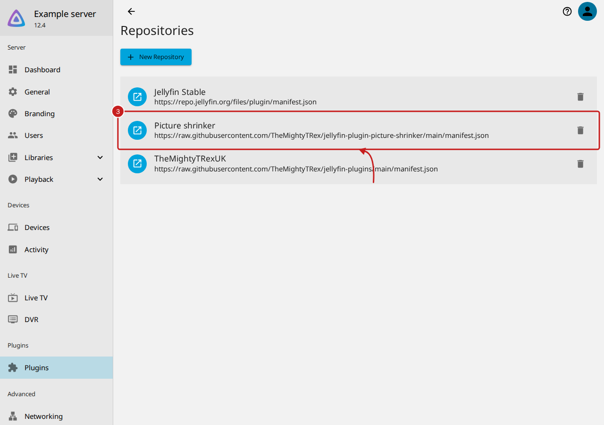
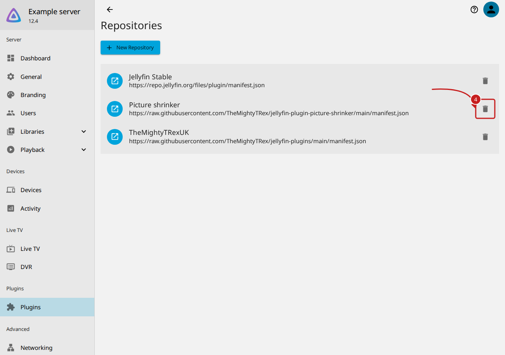
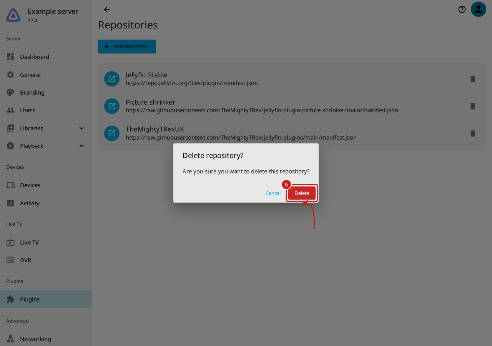

[Help centre](../README.md) · Add the plug-ins · how-to
<!-- help: start / add -->

# Move from the old Picture shrinker address

Picture shrinker used to have a repository address of its own. New versions are now listed only at the one address
for every plug-in by TheMightyTRexUK, so add the new address and remove the old one. What you installed stays
installed, with its settings. This takes 5 steps.

The old address, to remove:

```text
https://raw.githubusercontent.com/TheMightyTRex/jellyfin-plugin-picture-shrinker/main/manifest.json
```

The new address, to add:

```text
https://raw.githubusercontent.com/TheMightyTRex/jellyfin-plugins/main/manifest.json
```

## Before you begin

- An administrator account in Jellyfin.
- If you use Starboard, it makes this change for you the next time it offers Jellyfin plug-ins, in **Settings**,
  **Apps**, **Jellyfin**. Read [Use the plug-ins with Starboard](use-with-starboard.md).

## Steps

1. Add the new address: follow [Add the repository to Jellyfin](add-the-repository.md), steps 1 to 9.
2. Go to **Dashboard**, **Plugins**, then **Manage Repositories** (on a **Plugins** page with tabs, the **Repositories** tab).
3. Find the old address: it ends `jellyfin-plugin-picture-shrinker/main/manifest.json`, under the name you gave it,
   such as **Picture shrinker**.

   

4. Select the delete button beside the old address.

   

5. In **Delete repository?**, select **Delete**. The old address goes from the list, and **TheMightyTRexUK** stays.

   

## Things to note

- **Nothing you installed changes.** Picture shrinker keeps its version, its settings, its backup and its figures.
  The next update comes from the new address.
- **The old address still works** for the versions it already lists, so a Jellyfin that still has it is not broken;
  it only misses newer versions.

## Find out more

- [Add the repository to Jellyfin](add-the-repository.md)
- [Update Picture shrinker, or go back to an earlier version](../picture-shrinker/update-and-roll-back.md)
- [A plug-in is not in Jellyfin's catalogue](../fix/plug-in-not-in-the-catalogue.md)
