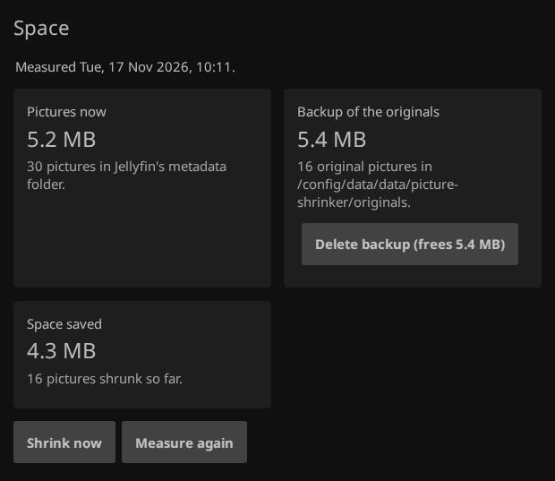
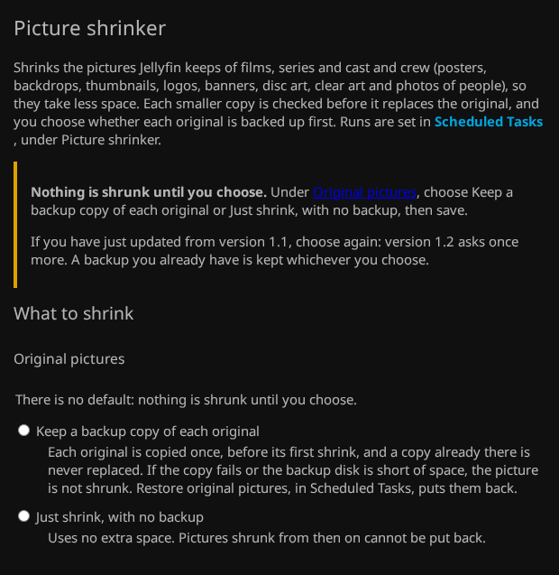
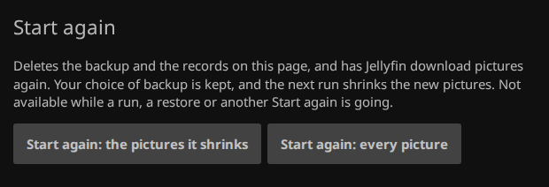

# Picture shrinker for Jellyfin

Works on any Jellyfin 10.11 or Jellyfin 12 server; you do not need Starboard.

A Jellyfin plug-in by TheMightyTRexUK, GPLv3 licence. Every task, with pictures, is in the
[help centre](https://themightytrex.github.io/jellyfin-plugins/).

> [!IMPORTANT]
> **After you install or update it, choose a backup option, or nothing is shrunk.** In Jellyfin, open **Dashboard**,
> **Plugins**, **Picture shrinker**, then **Settings**. Under **Original pictures**, choose **Keep a backup copy of each
> original** or **Shrink without a backup**, then **Save**. There is no default. Until you choose, the Dashboard's
> **Activity** list reminds you and **Shrink pictures** shows as failed in **Scheduled Tasks**.



## What it does

Jellyfin keeps a copy of every poster, backdrop, logo and photo of an actor or crew member it shows, often much larger
than any screen needs. On a large library they can take tens of gigabytes. Picture shrinker makes them smaller, for
example:

- **Posters** become 900 pixels tall, which is still sharp on a television.
- **Backdrops** become 1,920 pixels wide, sharp on a 1080p screen.
- **Photos of cast and crew** become 400 pixels wide.

Every picture type is shrunk by default. 'What it picks' lists them all.

Before a picture is replaced, the smaller copy is checked. If anything is wrong, the original stays as it was. You
choose whether each original is copied to a backup folder first: with a backup you can put every original back with
one task, and delete the backup when you are sure. **Start again** clears everything and has Jellyfin download the
pictures again.

## How to install it in Jellyfin

You need Jellyfin 10.11 or Jellyfin 12 and an administrator account. Everything is in Jellyfin's own dashboard. The
repository has a build for each: Jellyfin installs the one for its own version (1.2.3.0 on Jellyfin 12, 1.2.2.0 on
Jellyfin 10.11).

| Your Jellyfin | Version it installs | Built for |
|---|---|---|
| 12.0 to 12.4 | 1.2.3.0 | .NET 10 |
| 10.11 | 1.2.2.0 | .NET 9 |

To find your version, go to **Dashboard**: the version is under the server name in the menu.

1. Open Jellyfin in a web browser and sign in as an administrator.
2. Open the menu, then **Dashboard**, then **Plugins**.
3. Choose **Manage Repositories**, then **New Repository**. Fill in:
   - **Repository Name:** `TheMightyTRexUK`
   - **Repository URL:** `https://raw.githubusercontent.com/TheMightyTRex/jellyfin-plugins/main/manifest.json`

   This one address lists every Jellyfin plug-in by TheMightyTRexUK. If you added the old Picture shrinker address
   (`jellyfin-plugin-picture-shrinker`), add this one and remove the old one: this one lists every version.
4. Choose **Add**.
5. Back on **Plugins**, choose **Available** and search for `Picture`. Open **Picture shrinker**.
6. Choose **Install**, then **Install** again to confirm.
7. Restart Jellyfin: **Dashboard**, then **Restart** (or restart its container or service).

After the restart:

- **The settings** are in **Dashboard**, **Plugins**: choose **Installed**, open **Picture shrinker**, then **Settings**.
- **The tasks** are in **Dashboard**, **Scheduled Tasks**, under **Picture shrinker**: **Shrink pictures** and
  **Restore original pictures**.

Nothing is shrunk until you choose, on its settings page under **Original pictures**, **Keep a backup copy of each
original** or **Shrink without a backup**. There is no default. Then the first run is every Sunday at 03:30, or
when you choose **Shrink now**.



If you use Starboard, it can do all of this for you in **Settings**, **Apps**, **Jellyfin**, **Picture shrinker**.

## How it works

### What it picks

It works only in Jellyfin's metadata folder (in the official Docker image, `/config/metadata`; in the LinuxServer.io
image, `/config/data/metadata`).

| Picture | Where Jellyfin keeps it | Shrunk to |
|---|---|---|
| Posters | `poster.*` under `library` | At most 900 pixels tall (**Posters no taller than**, 300 to 3,000) |
| Photos of cast and crew | Pictures under `People` | At most 400 pixels wide (**Photos of people no wider than**, 100 to 2,000) |
| Backdrops | `backdrop.*`, `backdrop1.*` and so on under `library` | At most 1,920 pixels wide (640 to 3,840) |
| Thumbnails | `landscape.*` under `library` (Jellyfin saves its Thumb pictures with this name) | At most 1,280 pixels wide (480 to 3,840) |
| Logos | `logo.*` under `library` | At most 800 pixels wide (300 to 2,000) |
| Banners | `banner.*` under `library` | At most 1,000 pixels wide (300 to 3,000) |
| Disc art | `disc.*` under `library` | At most 500 pixels wide (200 to 2,000) |
| Clear art | `clearart.*` under `library` | At most 800 pixels wide (300 to 2,000) |

Only `.jpg`, `.jpeg`, `.png` and `.webp` pictures are shrunk, and never hidden files. Pictures saved beside your media
files, and every other picture, are left alone. A picture that is already small enough is only opened to read its
size, never written. Each picture keeps its format: JPEG and WebP at **Quality** 85, PNG lossless and with its
transparency, which matters for logos and clear art.

**What to shrink**, the first section of the settings page, holds the backup choice, **Shrink all picture types** and a tick
for each type. **Shrink all picture types** is active by default: every type is shrunk, and the ticks cannot be changed.
Deactivate it to choose the types yourself; each is ticked by default. Each type's size is under **Sizes**.

### The checks before a replace

For each picture that is too big:

1. A smaller copy is written to a hidden file beside it.
2. The copy is opened again and decoded in full, and must have exactly the new size and the original's format.
3. The copy must be smaller in bytes than the original. If it is not, the original is kept.
4. With **Keep a backup copy** chosen, the original is copied to the backup folder (read 'The backup'). If that fails, the picture is not
   shrunk.
5. The copy takes the original's file mode and owner and replaces it in one step (a rename), so Jellyfin never reads
   half a picture.

A picture that cannot be read is left as it is and listed on the settings page with the reason.

### When it runs

- **Shrink pictures** is a task in Jellyfin's **Scheduled Tasks**. It runs every Sunday at 03:30 until you change its
  triggers there: every day or every week, at the time you choose. **Once a month** on the settings page makes a
  weekly trigger run only the first time in each month.
- **Shrink now** on the settings page, or the run button in **Scheduled Tasks**, starts a run straight away. Stop it
  in **Scheduled Tasks**; it stops after the picture it is on.
- A run stops itself after 115 minutes, and the next run carries on: pictures already shrunk are only opened.
- It works at the lowest priority (nice 19 and the idle disk class), so people can watch while it runs.
- **Shrink new pictures soon after Jellyfin saves them** is deactivated by default. When activated, the posters and
  photos Jellyfin saves for new films, series and people are shrunk once they are 10 minutes old (**Wait before
  shrinking a new picture**), with the same checks and backup.
- A finished run sends no notification. Its only result is the figures on the settings page; Jellyfin's own
  **Scheduled Tasks** keeps its usual history of when each task ran.
- Until you choose a backup option, nothing is shrunk: **Shrink pictures** ends as failed in **Scheduled Tasks**, with
  the reason, and the Dashboard's **Activity** list says "Picture shrinker is waiting for you to choose" when Jellyfin
  starts, and again at most once a day when a run or a new picture is skipped.

### The backup

**Original pictures** on the settings page has two choices, and neither is chosen until you choose one:

- **Keep a backup copy of each original:** the backup described in this section.
- **Shrink without a backup:** no extra space is used, and pictures shrunk from then on cannot be put back.

Until you choose, nothing is shrunk: a scheduled run, a new picture and **Shrink now** each say "Not shrunk: choose
Keep a backup copy or Shrink without a backup, in its settings, first", and the settings page shows a notice.
**Restore original pictures**, **Delete backup** and **Start again** still work.

After the update from version 1.1, the old backup setting is no longer used, so you choose again. A backup
folder you already have is kept whichever you choose; **Delete backup** removes it.

With **Keep a backup copy**:

- Each original is copied once, before its first shrink, to the backup folder, keeping its place under `library` or
  `People`, so each one can be matched back. The folder is `picture-shrinker/originals` in Jellyfin's data folder
  (in the official Docker image, `/config/data/picture-shrinker/originals`; in the LinuxServer.io image,
  `/config/data/data/picture-shrinker/originals`) unless you choose another in **Backup folder**. The Space section
  on the settings page names the folder it uses.
- A copy already in the backup is never replaced, so a picture shrunk again at a new size still has its first
  original there.
- If the copy fails, or the backup disk would have less than 100 MB free, the picture is not shrunk and the run says
  why.
- **Restore original pictures**, in **Scheduled Tasks**, puts every original back where it came from and keeps the
  backup. It runs only when you choose it.
- **Delete backup**, on the settings page, removes the backup for good, after asking you. It frees the space the
  backup shows. It removes only the pictures the shrinker put in the backup folder, never anything outside it, and is
  not available while a run is going.

If you choose **Shrink without a backup**, the settings page warns that pictures shrunk from then on cannot be put back.

### Start again

**Start again**, on the settings page, clears everything and has Jellyfin download pictures again from the internet.
There are two, and each asks you first:



- **Start again: the pictures it shrinks:** every type in the table in 'What it picks', whatever is ticked in **What to shrink**
  (it is a reset, so a type you deactivated after shrinking it comes back too).
- **Start again: every picture:** Jellyfin replaces every picture of every film, series, season, collection and
  person, backdrops and logos included. Pictures you added yourself in Jellyfin are replaced. This downloads much
  more and can take many hours.

Each one, in order:

1. Is refused while a run, a restore or another Start again is going, and says so.
2. Deletes the backup, with the same safe rules as **Delete backup**.
3. Clears the records: the last runs, the space saved and the failures. Your choice of backup is kept.
4. Asks Jellyfin to download the pictures again, as refreshes in Jellyfin's own queue at low priority, with a short
   pause between them, so Jellyfin and the server are not flooded:
   - **The pictures it shrinks:** each picture is moved aside to a hidden file in the same folder
     (`.poster.jpg.picture-shrinker-old`), and Jellyfin refreshes the film, series, season, collection or person it
     belongs to. It refreshes the pictures in full but replaces none it has, so it downloads only the missing one,
     at full size. Metadata is filled in only where it is missing.
   - **Every picture:** nothing is moved. Jellyfin refreshes each library, with everything in it, and each person,
     replacing every picture.


The old picture is kept until Jellyfin has a new one, so a poster you uploaded yourself, or one no source has, is
never lost. Every 10 minutes while any are waiting, and at the start of each run, the shrinker checks them: once
Jellyfin has saved a new picture in that folder, the old one is deleted; after 24 hours with none, the old one is put
back under its own name. **Space saved** says how many are waiting, put back and replaced. The list is kept in the
plug-in's figures, so it carries on after a restart.

The next run shrinks the new pictures, backing them up first if **Keep a backup copy** is chosen.

### The Space section

The settings page shows, measured when the page opens and after each thing you do on it:

- **Pictures now:** the size and number of the pictures of the types it shrinks.
- **Backup of the originals:** the size and number of pictures in the backup, with **Delete backup** and the space it
  frees.
- **Space saved:** the space saved now and how many pictures are shrunk. Pictures put back by **Restore original
  pictures** no longer count. After **Start again**, it also says how many pictures are waiting for Jellyfin, how many
  were replaced by a new one and how many were put back.

**Last runs** lists each run: when, what started it, how many were shrunk, left as they were and not shrunk,
the space saved, and how it ended.

## Risks, and how to undo them

- **Pictures are changed in place.** Jellyfin shows the smaller picture straight away. With **Keep a backup copy**
  you can put the originals back; with **Shrink without a backup** you cannot, but **Start again** can have Jellyfin download
  them again.
- **The backup uses space until you remove it.** The first run copies every picture it shrinks, so it may need almost
  as much free space as the pictures take now. The Space section shows how much. When you are happy with the
  pictures, **Delete backup** frees it.
- **Deleting the backup cannot be undone.** After **Delete backup**, **Restore original pictures** can no longer put
  those pictures back. The shrunk pictures stay.
- **Smaller pictures are softer on very large screens.** 900 pixels tall is sharp on a television; on a large 4K
  screen up close a poster can be a little soft. Choose a larger size, or a higher **Quality**, if it matters to
  you. A picture already shrunk is not made larger again: restore it first.
- **Jellyfin may download bigger pictures again.** **Refresh metadata** with **Replace existing images** fetches new,
  full-size pictures. The next run shrinks them, but their backup is not replaced: the backup keeps the first original.
- **A run uses processor time.** It works at the lowest priority, but on a small server choose a quiet time for
  **Shrink pictures**, such as the night.
- **Do not run two shrinkers.** If you also use Starboard's Picture shrinker plug-in, it detects that this one is
  installed and stays idle, so the two never shrink the same pictures. Other tools that change Jellyfin's pictures
  should not run at the same time.

### Put the original pictures back

1. In **Dashboard**, **Scheduled Tasks**, **Shrink pictures**, remove its triggers (or the next run shrinks them
   again).
2. Run **Restore original pictures**.
3. In Jellyfin, a film or series may show the old picture until the page reloads.

### Remove the plug-in cleanly

1. To keep the pictures as they are now, skip to step 3. To put the originals back, follow 'Put the original pictures back' first.
2. To free the backup's space, choose **Delete backup** on the settings page.
3. In **Dashboard**, **Plugins**, **Installed**, open **Picture shrinker** and choose **Uninstall**, then restart Jellyfin.
4. If you did not delete the backup, its folder stays in Jellyfin's data folder (`picture-shrinker/originals`); you
   can delete it yourself. Two small files stay too, which you can delete: its settings,
   `plugins/configurations/Jellyfin.Plugin.PictureShrinker.xml`, and its figures, `plugins/Jellyfin.Plugin.PictureShrinker`,
   both in the folder that holds Jellyfin's `plugins` folder (`/config` in the official Docker image, `/config/data`
   in the LinuxServer.io image).

## How much it uses

Measured on 15 November 2026 on a sample of 540 made-up pictures (300 posters at 2,000 by 3,000 pixels and 240 photos
at 1,365 by 2,048), in a throwaway Jellyfin 10.11.11 container limited to 2 processors and 1.5 GB of memory, against
the Starboard version on the same sample.

| | Jellyfin version (this plug-in) | Starboard version |
|---|---|---|
| Where it runs | Inside Jellyfin | Its own container beside Jellyfin |
| Memory at rest | At most about 15 MB more than Jellyfin without it (164 MB against 148 MB; the samples overlap) | 13 MB (its whole container) |
| Memory at the peak of a run | About 20 MB more than Jellyfin at rest (183 MB against 164 MB) | 33 MB (its whole container) |
| Memory after a run | Back to Jellyfin at rest (164 MB) | 23 MB (the image library stays loaded) |
| Processor time for the run | 35 seconds | 39 seconds |
| Time the run took | 55 seconds (one processor at most, as it uses one thread) | 80 seconds (capped at half a processor) |
| Pictures shrunk | 540 of 540 | 540 of 540 |
| Space saved | 758.8 MB (776.3 MB to 17.5 MB) | 758.4 MB (776.3 MB to 17.9 MB) |
| Jellyfin's answers during the run | `/System/Info` every 2 seconds: median 25 ms, slowest 68 ms (at rest: 30 ms and 59 ms) | Not affected (a separate container) |

Both work at the lowest priority. At rest both are small (about 13 to 15 MB). The Jellyfin version uses slightly
less processor time and less memory during a run; the Starboard version keeps its memory apart from Jellyfin's, so a
problem in it can never slow Jellyfin. An earlier build of this
plug-in kept about 60 MB after a run; it now hands that memory back when each run ends.

## Why SkiaSharp

Jellyfin already loads SkiaSharp for its own pictures (`Jellyfin.Drawing.Skia`), with its native library for amd64
and arm64: version 3.116 in Jellyfin 10.11 and 3.119 in Jellyfin 12. Each build of this plug-in uses that copy: the
release zip holds only the plug-in's own DLL (about 100 KB), so there is nothing native to ship, nothing to download,
and no second copy of an image library in memory. ImageSharp would have added about 2 MB to every install and a second
decoder, and its licence needs care for some uses.

## Build it

One source makes two builds. `JELLYFIN_TARGET` picks which: `12` (the default) builds for Jellyfin 12 with the .NET 10
SDK, and `10.11` builds for Jellyfin 10.11 with the .NET 9 SDK. The builds run in Docker, from the top of the
[jellyfin-plugins](https://github.com/TheMightyTRex/jellyfin-plugins) repository, whose tools every plug-in shares:

```
JELLYFIN_TARGET=12 tools/dotnet.sh picture-shrinker test tests/Jellyfin.Plugin.PictureShrinker.Tests      # unit tests and the shared test pictures
JELLYFIN_TARGET=10.11 tools/dotnet.sh picture-shrinker test tests/Jellyfin.Plugin.PictureShrinker.Tests   # the same for the 10.11 build
tools/package.sh picture-shrinker                                                                         # both zips of the newest release in CHANGELOG.md
```

The zips are `artifacts/picture-shrinker_1.2.3.0_jellyfin-12.zip` and
`artifacts/picture-shrinker_1.2.2.0_jellyfin-10.11.zip`, each with its MD5 checksum. GitHub's **Build and test**
workflow builds and tests both on every change.

A release is one step: push a tag named by the plug-in's folder and its Jellyfin 12 version, such as
`picture-shrinker-v1.2.5.0`. The **Release** workflow builds and tests both builds, makes both zips and their MD5
checksums, creates one GitHub release with both, and adds both versions to Picture shrinker's entry in the
repository's one `manifest.json`. Versions up to 1.2.3.0 were released from the old repository,
TheMightyTRex/jellyfin-plugin-picture-shrinker, and `manifest.json` still lists them from there. [SYNC.md](SYNC.md) explains the version numbers.

The rules (sizes, quality, checks, backup) are in `rules.json`, shared with Starboard's version. [SYNC.md](SYNC.md)
says how the two are kept in step.

## Licence

GNU General Public Licence version 3 ([LICENSE](LICENSE)), as Jellyfin plug-ins need. Copyright 2026 TheMightyTRexUK.
